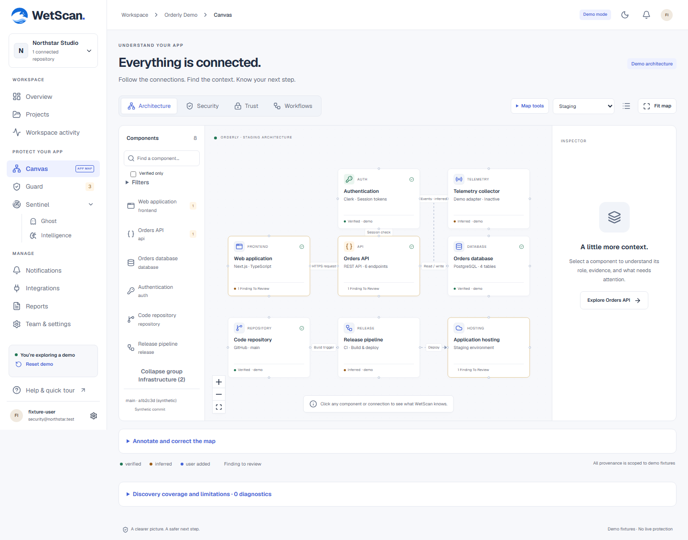
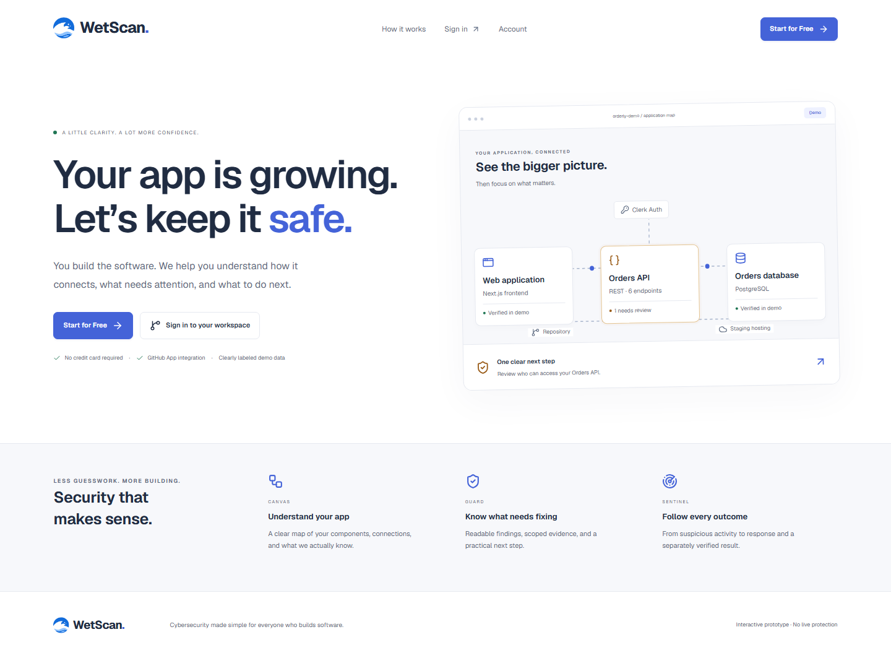
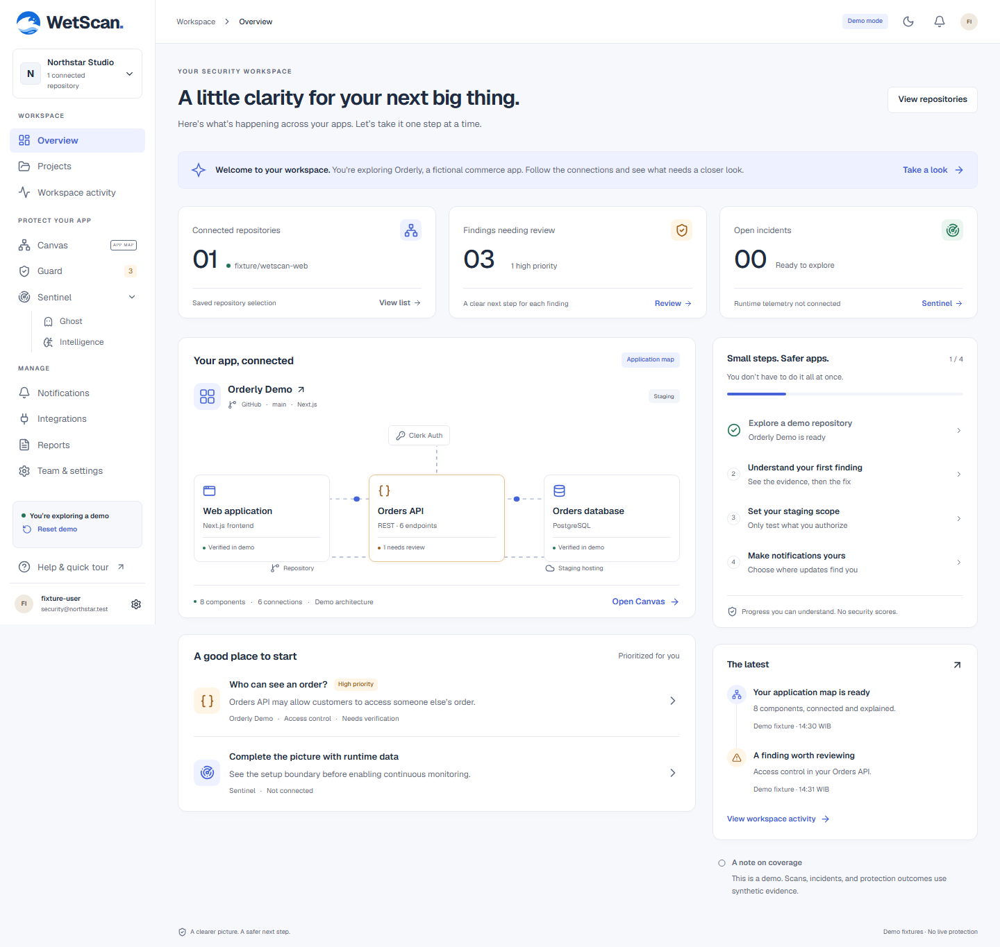
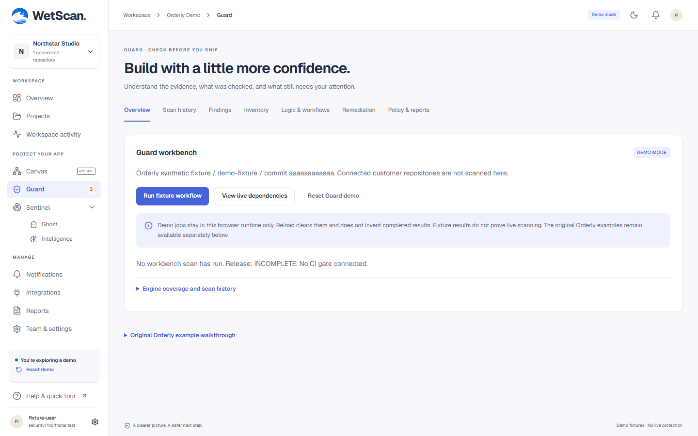
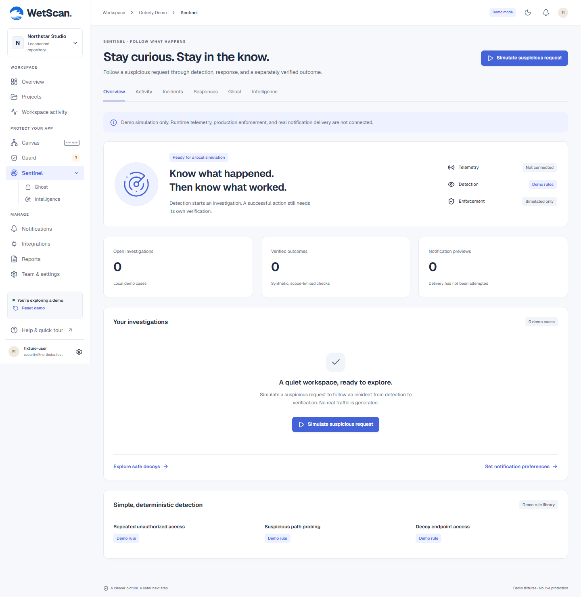
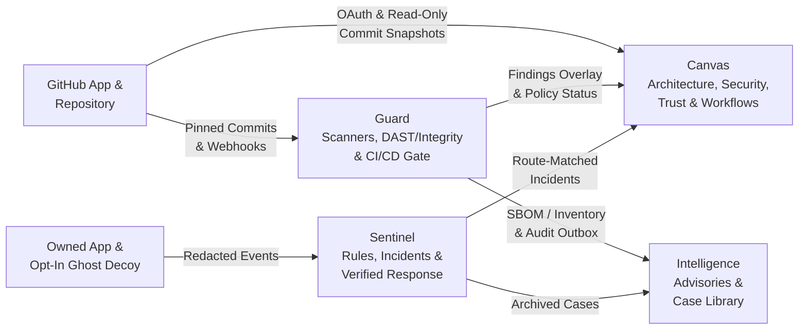

<div align="center">
  
  <h1>WetScan</h1>
  <p><strong>Understand your application. Secure what matters.</strong></p>
  <p>
    A developer-focused application security workspace connecting architecture mapping,
    repository security scanning, runtime telemetry investigation, and vulnerability intelligence
    around your GitHub repositories.
  </p>
  <p>
    <a href="#overview">Overview</a> ·
    <a href="#why-wetscan">Why WetScan</a> ·
    <a href="#core-features">Core Features</a> ·
    <a href="#how-wetscan-works">How It Works</a> ·
    <a href="#getting-started">Getting Started</a> ·
    <a href="#project-status">Project Status</a> ·
    <a href="#documentation">Documentation</a>
  </p>
</div>

---



> _WetScan Canvas inspecting the built-in `Orderly Demo` interactive workspace (`Demo mode`)._

<details>
<summary>More screenshots (Landing, Workspace Overview, Guard, Sentinel)</summary>

| Landing                                                   | Workspace Overview                                                                        |
| --------------------------------------------------------- | ----------------------------------------------------------------------------------------- |
|  |  |

| WetScan Guard (`Orderly Demo`)                                                      | WetScan Sentinel (`Orderly Demo`)                                                        |
| ----------------------------------------------------------------------------------- | ---------------------------------------------------------------------------------------- |
|  |  |

</details>

---

## Overview

Application security context is often fragmented across disconnected tools: one system inspects code and dependencies, another tracks CI checks, a third collects runtime logs, and architecture diagrams live in static wikis that fall out of date.

WetScan brings those workflows into a single workspace built around **GitHub-connected applications**:

- **Canvas** maps your application components, routes, and static dependencies from repository source or sample fixtures.
- **Guard** runs repository-pinned security scans, scoped staging verification, and deterministic CI/CD release checks.
- **Sentinel** ingests structured runtime telemetry, evaluates deterministic rules, manages incident investigations, and verifies mitigation outcomes separately from action execution.
- **Intelligence** separates evidence-based internal incident patterns from external vulnerability advisories and declared dependency exposure.
- **Ghost** adds opt-in, default-disabled decoy endpoints to surface suspicious interactions with minimal data retention.

WetScan treats evidence boundaries explicitly: a detected signal is not a confirmed compromise, a policy evaluation is not merge enforcement without repository rules, an accepted response action is not verified neutralization, and a matched dependency advisory is not proof of runtime exploitation.

---

## Why WetScan?

- **See how your app connects before triaging issues** — Anchor security findings and alerts to discovered frontend, API, auth, database, and infrastructure components rather than raw file paths alone.
- **Shift verification earlier in GitHub workflows** — Evaluate SAST, SCA, secrets, IaC, and SBOM coverage on pinned commits with deterministic `PASS`, `WARN`, `BLOCK`, and `INCOMPLETE` gates that never treat missing scanner coverage as passing.
- **Separate execution from proof** — Distinguish between applying a response or fix proposal and independently verifying that an attack vector is blocked while legitimate behavior still succeeds.
- **Keep runtime and advisory context grounded** — Pair append-only incident timelines with declared dependency exposure checks across CISA KEV, GHSA, and OSV advisories.
- **Reduce context switching** — Navigate from a component on the architecture map to its code evidence, workflow invariants, incident timeline, and exportable security report inside one interface.
- **Explore safely before wiring live infrastructure** — Use the built-in `Orderly Demo` fixtures to test end-to-end workflows with zero external side effects, then enable live database, scanner, and worker components explicitly via environment flags.

---

## Core Features

### WetScan Canvas

Visualize application topology, security coverage, trust boundaries, and state workflows in an interactive graph or accessible list view.

- **Source-Driven Discovery:** Analyzes authorized GitHub repository trees and blobs using bounded TypeScript syntax AST parsing (`canvas-next-ts/1.0.0`) without cloning repositories or executing application code. Graphs are stored in an encrypted local cache keyed by workspace, repository, and commit SHA.
- **Four Focused Lenses:**
  - **Architecture:** Explore discovered UI sections, Next.js App/Pages API routes, auth/ORM/database SDK references, and static import paths with upstream/downstream dependency tracing.
  - **Security:** Overlay Guard findings and route-matched Sentinel incidents directly onto components, while explicitly surfacing unmatched items and coverage gaps.
  - **Trust:** Model expected roles, resource ownership, and allow/deny boundaries (observed policy enforcement remains marked _Not tested_ until verified).
  - **Workflows:** Inspect and edit application state machines, preconditions, and invariants before generating unexecuted verification plans for Guard.
- **Annotations & Exports:** Add manual components, edges, and notes alongside generated observations, and export architecture models as redacted JSON or readable summaries.

### WetScan Guard

Run commit-pinned code analysis, scoped dynamic checks, CI/CD release gates, and cross-module security reporting for authorized GitHub repositories.

> **Scope note:** Repository onboarding and source acquisition support **GitHub repositories only**. GitLab repository readers and archive/ZIP uploads are outside the current product scope.

- **Static & Supply-Chain Scanning:** Executes pinned CLI engines in isolated Docker containers over immutable GitHub commit snapshots:
  - **SAST** (`Opengrep`) — Bounded JavaScript/Python rule set in the local scanner profile.
  - **SCA** (`OSV Scanner`) — Dependency vulnerability matching (offline npm database in the local container profile).
  - **Secrets** (`Gitleaks`) — Credential pattern detection without storing matched secret values.
  - **IaC** (`Trivy`) — Static checks for Terraform, Kubernetes manifests, and Dockerfiles.
  - **SBOM** — CycloneDX dependency inventory metadata (with a container-image scan path exercised against OCI fixtures).
- **Redacted Evidence, Retests & Guidance:** Findings bind to commit SHA, engine provenance, and artifact digests. Deterministic rule guidance is built in; an optional OpenAI rule-explanation adapter can be enabled explicitly with policy consent (sending only engine, rule ID, severity, and confidence metadata — never source code). Guard does **not** automatically author patches or open pull requests.
- **Scoped Staging DAST & 5-Invariant Integrity Runner:** When enabled (`GUARD_G05_ENABLED=1`), executes bounded checks against explicitly authorized staging targets using an SSRF-enforcing egress client and AES-256-GCM sealed synthetic test credentials. Tests security headers, CORS reflection, auth/session boundaries, open redirects, and five integrity invariant families (`ownership`, `workflow_bypass`, `state_transition`, `replay`, `unauthorized_modification`) with pre/post state diffs and verified cleanup.
- **CI/CD Security Gate:** Verifies signed GitHub webhooks (`X-Hub-Signature-256`), queues commit-pinned triggers, evaluates deterministic project policies, and publishes GitHub Check Runs (`WetScan Guard / Security gate`) with bounded scheduled scans and read-only Vercel deployment inspection.
- **Unified Reports & Bridges:** Aggregates scan, CI/CD, and DAST/Integrity states into Unified Guard Security Reports (JSON and XSS-safe HTML) and syncs Guard findings and inventory into Canvas and Sentinel Intelligence.

### WetScan Sentinel

Monitor runtime telemetry, detect deterministic anomalies, manage incident investigations, and run controlled, independently verified responses.

- **Authenticated Telemetry & Event Explorer:** Ingests bounded security events via `/api/sentinel/ingest` using revocable, hashed source credentials, field allowlisting/redaction, nonce replay deduplication, and cursor-paginated exploration.
- **Deterministic Detection Rules & Alerts:** Evaluates UTC epoch-aligned tumbling-window rules (`DRAFT`, `ENABLED`, `DISABLED`) with configurable cooldowns, suppression windows, and deduplicated alerts.
- **Incident Investigation:** Correlates alerts into project-scoped incidents (`open`, `investigating`, `closed`) with append-only audit timelines.
- **Controlled Response & Separate Verification:** Separates proposing and approving a reversible response (such as a temporary rate limit) from applying it, and requires an independent verification check proving both the malicious replay is blocked and benign traffic remains allowed before marking neutralization verified. Locally verified against an isolated loopback rate-limit fixture; no production WAF/CDN/firewall integration is included.
- **Notifications & Reporting:** Uses a separate least-privilege notifier worker (`worker/notifier/main.ts`) supporting Telegram and Resend adapters (when configured with owner credentials), consent gates, quiet hours, throttling, and a delivery ledger that distinguishes provider API acceptance from confirmed recipient delivery. WhatsApp delivery is not integrated.

### WetScan Intelligence

Keep internal investigation lessons cleanly separated from external vulnerability feeds.

- **External Advisories & Potential Exposure:** Syncs **CISA KEV**, **GitHub Global Security Advisories (GHSA)**, and **OSV** into a shared advisory catalog (NVD is deferred). Evaluates potential repository exposure at read time against root `package-lock.json` (v2/v3) or Guard-synced inventory using ecosystem-specific version comparators (SemVer for npm, crates.io, and Go; PEP 440 for PyPI). Matched advisories are labeled as _potential_ exposure of declared dependencies, never confirmed exploitation.
- **Internal Case Library:** Archives closed or reviewed incidents with immutable evidence references, deterministic exact-signature grouping (no LLM clustering), and human-reviewed `DRAFT` rule candidates that require explicit approval, validation, and separate enablement.

### WetScan Ghost

Add low-noise, opt-in decoy signals for owned applications without capturing sensitive caller data.

- **Default-Disabled Safety:** Ghost endpoints (e.g., `/__wetscan/ghost-decoy` or `/.well-known/...`) stay off until explicitly configured for an owned application and enabled project rule (`controlled-decoy-v1`).
- **Privacy-Preserving Signals:** Immediately discards request bodies and omits `Authorization`, `Cookie`, forwarded headers, query strings, and raw IP addresses, emitting normalized `ghost.decoy_triggered` events into Sentinel.
- **Honest Signal Semantics:** Surfaces hits as suspicious indicators for review — explicitly warning that automated crawlers or scanners can trigger decoys — without autonomous intrusion prevention or automated traffic blocking.

---

## How WetScan Works



1. **Authenticate and select repositories:** Sign in via the configured GitHub App during onboarding and choose which repositories belong to your workspace.
2. **Map architecture in Canvas:** Inspect discovered components, routes, and SDK connections, then review Trust and Workflow models.
3. **Scan commits in Guard:** Run SAST, SCA, secrets, IaC, and SBOM scans on pinned commits (or explore preloaded scenarios in `Orderly Demo`).
4. **Evaluate release & staging checks:** Review redacted evidence, check CI/CD policy verdicts, and run scoped DAST or Integrity checks against authorized staging targets.
5. **Investigate runtime signals in Sentinel:** Ingest structured telemetry or opt-in Ghost decoy events, review rule alerts, and manage incident timelines.
6. **Verify responses independently:** Approve bounded responses and verify attack mitigation alongside benign control checks before closing cases.
7. **Connect intelligence & reports:** Archive lessons into the Case Library, cross-check declared dependencies against external advisories, and export JSON, CSV, or HTML reports.

---

## Getting Started

### Prerequisites

- **Node.js `22.20+`** (CI pins `22.20.0`) and **npm**
- **GitHub App** credentials (required to sign into `/app` and connect repositories)
- **Optional (for live scanning, databases, and full E2E):**
  - **Docker** and **PostgreSQL 17 or 18** (for Guard scanners, Sentinel storage, and worker queues)
  - **Playwright Chromium** (`npx playwright install chromium`) for browser E2E tests

### 1. Clone and Install

```bash
git clone https://github.com/wilanta/wetscan-prototype.git
cd wetscan-prototype
npm ci
```

### 2. Configure Authentication & Workspace Environment

Copy `.env.example` to `.env.local` (ignored by Git) and populate your local values:

```bash
cp .env.example .env.local
```

Required variables in `.env.local`:

| Variable                   | Purpose                                                                               |
| -------------------------- | ------------------------------------------------------------------------------------- |
| `APP_URL`                  | Origin URL, e.g., `http://localhost:3000` (use `localhost` consistently during OAuth) |
| `AUTH_SECRET`              | High-entropy secret at least 32 bytes long for AES-256-GCM session/auth encryption    |
| `AUTH_DATA_DIR`            | Absolute writable path **outside** this repository and any public web root            |
| `GITHUB_APP_ID`            | Numeric GitHub App ID                                                                 |
| `GITHUB_APP_SLUG`          | GitHub App slug (`github.com/apps/<slug>`)                                            |
| `GITHUB_APP_CLIENT_ID`     | GitHub App OAuth client ID                                                            |
| `GITHUB_APP_CLIENT_SECRET` | GitHub App OAuth client secret                                                        |
| `GITHUB_APP_PRIVATE_KEY`   | RSA private key PEM from the GitHub App (supports multiline or `\n`-escaped)          |

Configure your GitHub App with `Metadata: read` and `Contents: read`, set both **Setup URL** and **User authorization callback URL** to `http://localhost:3000/api/auth/github/callback`, leave _Request user authorization (OAuth) during installation_ **OFF**, and enable _Redirect on update_. See [Authentication & Onboarding](docs/AUTH-ONBOARDING.md) for full details.

### 3. Start the Local Server

```bash
npm run dev
```

Or run a production build locally:

```bash
npm run build
npm start
```

Open [http://localhost:3000](http://localhost:3000) and sign in via `/onboarding` or `/login`.

> **Important:** Running `npm run dev` starts the Next.js web application only. It does **not** automatically provision PostgreSQL, start Docker scanners, ingest live telemetry, or enable external notification providers.

### Interactive Demo vs. Live Development

| Mode                                  | How to Access                                                                                                                       | What Runs                                                                                                                                                                           | External Infrastructure Needed                                                                             |
| ------------------------------------- | ----------------------------------------------------------------------------------------------------------------------------------- | ----------------------------------------------------------------------------------------------------------------------------------------------------------------------------------- | ---------------------------------------------------------------------------------------------------------- |
| **Interactive Demo (`Orderly Demo`)** | Complete `/onboarding` login and open **Orderly Demo** (`/app/projects/orderly-demo`), or run the isolated stubbed E2E suites below | Full clickable Canvas, Guard workbench, Sentinel incidents, Ghost decoy simulation, Intelligence previews, and resettable in-memory state                                           | GitHub App login for `/app` (or zero external credentials when using the automated test-stubbed runners)   |
| **Live Development (`github-<id>`)**  | Open any selected GitHub repository under `/app/projects`                                                                           | Source-backed Canvas maps immediately; Guard live scans, CI/CD Gate, DAST/Integrity, and Sentinel live views activate only when databases, workers, and opt-in flags are configured | GitHub App + local PostgreSQL 17/18 + Docker (Guard scanners) + separate worker processes & approval files |

To preview the Interactive Demo and Guard/Auth workflows end to end **without setting up a live GitHub App**, you can run the repository's self-contained, stubbed-GitHub Playwright runners:

```bash
npx playwright install chromium
node tests/auth/run-github-e2e.mjs
node tests/mvp/run-integrated-e2e.mjs tests/mvp/playwright.config.ts
```

### Verification Commands

All commands below are defined in `package.json`:

```bash
npm run typecheck             # TypeScript check (tsc --noEmit)
npm run lint                  # ESLint across the repository
npm test                      # Unit and contract suite (Vitest)
npm run sentinel:secret-scan  # Tracked-file secret and credential shape scan
npm run test:mvp              # Offline MVP unit checks
npm run test:guard:live       # Offline Guard live unit checks
npm run build                 # Next.js production webpack build
```

For full PostgreSQL, Guard scanner, and Sentinel worker setup, follow the guides in [Documentation](#documentation).

---

## Technology Stack

| Layer                   | Technologies                                                                                                                                                                                                   |
| ----------------------- | -------------------------------------------------------------------------------------------------------------------------------------------------------------------------------------------------------------- |
| **Frontend**            | Next.js 16.4 (App Router), React 19.3, TypeScript 6, React Flow (`@xyflow/react`), Dagre, Radix UI Dialog, Tailwind CSS v4, Lucide icons, Sonner                                                               |
| **Backend & Storage**   | Next.js Route Handlers & Server Components, PostgreSQL 17/18 (`pg` parameterized SQL, `FORCE ROW LEVEL SECURITY`, least-privilege roles), AES-256-GCM encrypted file stores (`AUTH_DATA_DIR`)                  |
| **Authentication**      | GitHub App OAuth + installation verification (`HttpOnly` `SameSite=Lax` cookies, PKCE, CSRF origin checks)                                                                                                     |
| **Analysis & Scanning** | TypeScript Compiler AST (Canvas discovery), Opengrep (SAST), OSV Scanner (SCA), Gitleaks (Secrets), Trivy (IaC / Container), CycloneDX (SBOM), Docker container isolation                                      |
| **Workers & Queues**    | Standalone Node.js worker loops (`worker/sentinel`, `worker/notifier`, and Guard CI/CD, DAST, and integration dispatchers/workers) backed by PostgreSQL job and transactional outbox tables with lease fencing |
| **Testing & Quality**   | Vitest, Playwright, `@axe-core/playwright`, ESLint, Prettier, custom repository secret scanner                                                                                                                 |

---

## Project Status

WetScan is under active development. The table below summarizes what is usable today versus what requires service setup or remains outside current scope:

| Capability                                                                                  | Current Status                          | Notes                                                                                                                                                                                                                                                                               |
| ------------------------------------------------------------------------------------------- | --------------------------------------- | ----------------------------------------------------------------------------------------------------------------------------------------------------------------------------------------------------------------------------------------------------------------------------------- |
| **Orderly Interactive Demo**                                                                | Ready locally                           | Full UI walkthrough across Canvas, Guard, Sentinel, Ghost, Intelligence, Notifications, and Reports with deterministic sample fixtures (requires local Auth/GitHub session or test-fixture runner)                                                                                  |
| **Canvas (GitHub Source Maps)**                                                             | Ready with GitHub App                   | Analyzes authorized GitHub repositories at pinned commits with encrypted local file caching                                                                                                                                                                                         |
| **Guard Code & Supply-Chain Scans**                                                         | Locally verified (isolated env)         | SAST, SCA, Secrets, IaC, and SBOM verified against local PostgreSQL + Docker scanner image (`GUARD_PRODUCT_ENABLED`); container scan verified on OCI fixtures                                                                                                                       |
| **Guard Scoped DAST & Integrity**                                                           | Locally verified (synthetic staging)    | Verified against isolated PostgreSQL 18 + Docker synthetic staging target (`GUARD_G05_ENABLED` off by default); external staging targets require owner setup                                                                                                                        |
| **Guard CI/CD Gate & Cross-Module Bridges**                                                 | Partially verified locally              | Webhook intake, policy gate, Canvas overlay, Intelligence sync, and Unified Reports verified locally; real GitHub `checks:write` webhooks, branch-protection merge blocking, Vercel Deployment Checks, and live Sentinel pipeline consumer endpoints require external configuration |
| **Sentinel Telemetry, Detection, Incidents, Response, Notifications, Ghost & Intelligence** | Locally verified (isolated DB/fixtures) | PostgreSQL RLS, worker loops, loopback rate-limit response fixture, loopback Ghost decoy, KEV/GHSA/OSV sync, and Case Library verified locally; live target ingestion and Telegram/Resend delivery require owner-supplied credentials and activation approvals                      |
| **Out of Scope / Not Connected**                                                            | Unavailable                             | GitLab repositories, ZIP upload scanning, autonomous AI patch/PR creation, WhatsApp delivery, NVD feed sync, production WAF/firewall enforcement, and unattended production deployment readiness                                                                                    |

---

## Documentation

### Setup & Authentication

- [Authentication & Onboarding](docs/AUTH-ONBOARDING.md) — GitHub App configuration, OAuth/installation flow, session storage, and troubleshooting
- [Dashboard Session Integration](docs/DASHBOARD-SESSION.md) — Workspace session state and repository directory behavior
- [Environment Templates](.env.example) & [Sentinel DB Template](.env.sentinel.example) — Reference environment variable names (copy to `.local` files; never commit secrets)
- [Sentinel Local PostgreSQL Compose](infra/sentinel/compose.yaml) — Container configuration for local Sentinel database setup

### Canvas

- [Canvas Architecture](docs/CANVAS_ARCHITECTURE.md) — Source discovery bounds, four lenses, Trust/Workflow editors, and exports
- [Canvas GitHub Integration](docs/CANVAS_GITHUB_INTEGRATION.md) — Authorized repository snapshot retrieval and security boundaries
- [Canvas Performance & Caching](docs/CANVAS_PERFORMANCE.md) — Encrypted graph cache lifecycle and layout behavior

### Guard

- [Guard Architecture](docs/GUARD_ARCHITECTURE.md) — Core domain model, security boundaries, and worker isolation requirements
- [Guard Local Scanner & DB Setup](docs/GUARD_G02_NEW_LOCAL_ENV_SETUP.md) — Provisioning isolated PostgreSQL and Docker scanner images
- [Guard CI/CD Gate Architecture](docs/GUARD_G04_ARCHITECTURE.md) & [CI/CD Provider Setup](docs/GUARD_G04_PROVIDER_SETUP.md) — Webhooks, Check Runs, branch enforcement, and Vercel verification
- [Guard DAST & Integrity Architecture](docs/GUARD_G05_ARCHITECTURE.md) & [Synthetic Staging Setup](docs/GUARD_G05_STAGING_SETUP.md) — Scoped DAST, sealed test accounts, and 5-invariant verification
- [Guard Integrations & Unified Reports](docs/GUARD_G06_ARCHITECTURE.md) & [Guard Release Readiness](docs/GUARD_RELEASE_READINESS.md) — Canvas/Sentinel bridges, unified reports, and readiness gates
- [Guard Testing Guide](docs/GUARD_TESTING.md) — Offline and scanner verification commands

### Sentinel, Intelligence & Ghost

- [Sentinel Architecture](docs/SENTINEL_ARCHITECTURE.md) — Modular monolith design, telemetry-to-incident pipeline, and action boundaries
- [Sentinel Operational Runbook](docs/SENTINEL_S11_OPERATIONAL_RUNBOOK.md) & [Sentinel Readiness Matrix](docs/SENTINEL_S11_RELEASE_READINESS.md) — Worker processes, migrations, backups, health checks, and current readiness
- [Controlled Response](docs/SENTINEL_S05_ARCHITECTURE.md) — Approval, independent verification, and TTL rollback semantics
- [Notifications](docs/SENTINEL_S06_ARCHITECTURE.md) — Isolated notifier worker, consent checks, and delivery ledger
- [Ghost Decoys](docs/SENTINEL_S07_ARCHITECTURE.md) — Opt-in decoy paths and privacy guarantees
- [Internal Case Library](docs/SENTINEL_S08_ARCHITECTURE.md) & [External Advisories](docs/SENTINEL_S09_ARCHITECTURE.md) — Evidence-backed grouping, draft rules, and KEV/GHSA/OSV exposure matching
- [Live Canvas Overlay & Reports](docs/SENTINEL_S10_ARCHITECTURE.md) — Route-matched incident overlays and JSON/CSV exports

---

## Security

This repository does not currently publish a `SECURITY.md` file or dedicated private vulnerability-reporting address.

If you discover a security issue in WetScan, **please do not post sensitive exploit details, credentials, or reproduction payloads in public GitHub issues or pull requests**. Contact the repository maintainer privately through GitHub before sharing details publicly.

---

## License

No `LICENSE` file is currently present in this repository (`package.json` marks the package as `"private": true`). Licensing terms have not yet been specified; contact the repository owner before redistributing or using this software outside authorized evaluation.
