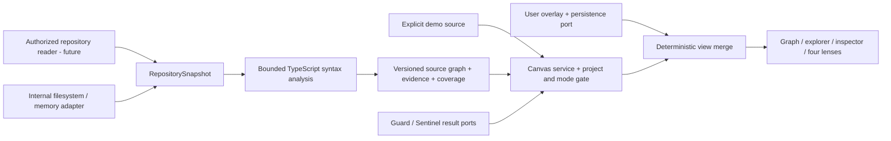

# WetScan Canvas

Implementation on `feat/canvas-full-module`, based on fetched `master@7d9a285` (14 November 2026). No commit, push, merge, schema change or deployment is included. External integration status is tracked in [INTEGRATION_BACKLOG.md](INTEGRATION_BACKLOG.md); executed checks and limitations are in [CANVAS_VALIDATION.md](CANVAS_VALIDATION.md).

## Ownership and retained behavior

The original checkout was clean. Work is isolated in sibling worktree `wetscan-canvas-full`. Changes are in `src/components/views/canvas.tsx`, `src/features/canvas/**`, `tests/canvas/**` and the three Canvas documentation files. One shared configuration change adds only `tests/canvas/fixture/.next/**` to `eslint.config.mjs` ignores, so generated test-host bundles are not linted as source. Auth, session, onboarding, proxy, application shell, root layouts, route dispatcher, shared types, dependencies and lockfile are unchanged. Daud's routes and workspace access checks remain authoritative.

The Canvas export and original `/app/projects/orderly-demo/canvas` route are retained. The existing Orderly components, positions, synthetic revision, four lenses, environment empty state, graph/list, keyboard selection, source legend, finding links, demo Guard remediation and Integrity navigation, Sentinel incidents, provider/branch state and surrounding demo reset remain available. Canvas has a separate **Reset Canvas edits** action for its annotation/model storage; the shell's **Reset demo** still resets the existing demo reducer. Global reset does not clear the separate Canvas storage while the feature is unmounted (CAN-017).

The renderer contains no checks for `orders-api` or `FIND-102`. Fixture-specific relationships, positions, finding links, scenario IDs and fallback focus are in the demo adapter. Fixture provenance means supported by the fixture definition only.

## Data flow



Generated architecture remains separate from the user overlay. Nodes and edges have semantic project-scoped IDs, schema version 1 and analyzer version `canvas-next-ts/1.0.0`. Direct source observations include evidence paths, line locations and pinned revisions; they do not prove runtime behavior. Generated IDs win collisions with manual additions. Missing nodes leave orphaned annotations in the exported overlay and produce diagnostics. Hidden nodes, unconfirmed relationships, trust boundaries, groups and positions never rewrite the source graph.

## File map

| Path under `src/features/canvas`                           | Responsibility                                                                                                                        |
| ---------------------------------------------------------- | ------------------------------------------------------------------------------------------------------------------------------------- |
| `types.ts`, `contracts.ts`, `validation.ts`                | Graph, evidence, coverage, overlays, policy/workflow models, runtime decoding and integration ports                                   |
| `discovery/safety.ts`, `snapshot.ts`                       | Allowlisted relative paths, denied credentials/stores, memory snapshot and bounded inputs                                             |
| `discovery/source-parser.ts`                               | TypeScript syntax AST, imports/references, exported methods and route normalization; no typechecking or execution                     |
| `discovery/analyzer.ts`                                    | Framework manifests, App/Pages API routes, frontend sections, actual SDK references, import chains, schema/CI/deployment observations |
| `discovery/fixtures.ts`                                    | Five sanitized internal source snapshots A–E                                                                                          |
| `adapters/local-snapshot.ts`                               | Trusted-root filesystem input for CLI/tests only; no route imports                                                                    |
| `adapters/demo-source.ts`                                  | Legacy fixture compatibility mapping, scoped Guard/Sentinel/Trust/Integrity demo results                                              |
| `adapters/snapshot-source.ts`                              | Server/CLI snapshot analysis with project/revision checks                                                                             |
| `adapters/fixture-graphs.json`                             | Reproducible graph output of the five source examples; no raw source; keeps TypeScript parser out of browser bundle                   |
| `adapters/overlay-unavailable.ts`, `overlay-validation.ts` | Honest missing coverage; runtime result validation and safe internal action links                                                     |
| `adapters/persistence.ts`                                  | Versioned demo-only browser annotation storage and memory persistence; no generated graph/findings in localStorage                    |
| `graph/{ids,model,layout}.ts`, `service.ts`                | Stable IDs, normalization, merge, filters, cycle-safe deterministic layout, scope gates and failed-overlay recovery                   |
| `trust/model.ts`, `workflows/model.ts`                     | Expected policy editing, three example templates, transition reconciliation and deterministic unexecuted plans                        |
| `hooks/use-canvas.ts`                                      | Source lifecycle, asynchronous loading/error state, manual history (50 entries), persistence failures and reset                       |
| `components/*`                                             | Feature page, graph renderer, evidence/inspector, manual editor, Trust/workflow editors, scoped responsive styles                     |
| `export.ts`                                                | Explicit export projections, common credential redaction, readable summary and browser download                                       |
| `run.mjs`, `cli.ts`                                        | Node 22 offline analysis and fixture regeneration without changing shared compiler options                                            |

`src/components/views/canvas.tsx` is now only the public re-export. No shared service/type mutation was needed. No packages were added: TypeScript's existing parser is used only in Node; React Flow and Radix/UI components already exist. Layout uses a small deterministic layered algorithm, so no Dagre dependency is required.

## Offline analysis and boundaries

The analyzer takes a `RepositorySnapshot`, lists/read texts through that port, and returns an `ArchitectureGraph`. It never fetches, clones, installs dependencies, builds, evaluates configs, executes code or sends source to an AI/provider. Next App Router groups, nested/dynamic/catch-all APIs and exported named HTTP methods are recognized. Pages `index` conventions are normalized; Pages handler methods remain unknown. Manifest framework detection is explicitly different from concrete SDK use. Verified edges describe static imports (including bounded local wrapper chains), not proven HTTP/database activity. CI files prove configuration only; hosting stays inferred. Prisma datasource providers are source observations, never provisioned databases.

Default limits: 1,200 entries, 256,000 bytes/file, 8,000,000 total bytes, depth 16 and an 8-second cooperative time budget. Listings and reads time out even when a promise does not settle. TypeScript parsing is synchronous; its cost is bounded by file size and checked between files, not preempted mid-file. Import traversal is limited to 100 source files per root. Limits/exclusions and unknown/malformed files produce partial diagnostics. Unsafe paths/content are omitted, never echoed in error messages. The local adapter rejects symlinks/junction escapes and binary text; `.env.example` yields names plus `[redacted]` only. Source `auth/session.ts` is parseable; session **stores**, private keys, credentials, `.env` and vendored/generated directories are excluded.

Supported SDK rules: Auth.js, Clerk, Firebase Auth, Supabase auth helpers, Prisma, Drizzle, pg/postgres, Mongo clients, Supabase SDK, Stripe, S3 SDK, Redis and queue clients. Rules are inspectable in `analyzer.ts`. Common JSONC tsconfig wildcard aliases are resolved without evaluating configs. `extends`, package exports, arbitrary compiler plugins, custom module resolution, shadowed bindings and CommonJS/dynamic imports are not fully resolved; all output is a partial static map (CAN-016). No arbitrary fetch URL creates an edge. OpenAPI endpoints and generic framework-specific route analysis are extension backlog, not supported claims.

## View editing, Trust and Workflows

Search and kind/provenance filters affect both explorer and graph; edges require visible endpoints. Security severity/status/source/priority filter the result overlay; **Only affected components** narrows the graph. Selection is retained across lenses; hidden/missing selections show recovery rather than stale evidence. Nodes can be dragged; positions persist independently. Auto layout, reset layout, related filtering, hide/unhide, group collapse, manual nodes/edges, notes and boundary markers are functional. On phones there is a readable component/connection list and a separate inspector.

Trust edits roles, linked resources, arbitrary actions, ownership, allow/deny and explicit expected-policy confirmation. Observed policy remains **Not tested**. The old Customer/Staff/Admin simulated observation is displayed in a separate sample panel; changing expected policy cannot turn it into a test result.

Workflow editing supports names, linked component, actor transitions, allowed/forbidden edges, state addition/removal/renaming, preconditions, endpoint placeholders, expected HTTP status, assertions, hypotheses, invariants and protected fields. Removing a state removes its transitions. Graph and table are both available. Order status lock, locked grades and approval are examples requiring owner review. Trust and Integrity exports always say `not_executed`; real execution buttons explain the missing Guard dependency. Existing demo Integrity outcome/retest remains separately labeled.

JSON export includes generated architecture plus the user overlay separately. Readable summary includes source uncertainty and coverage. Arbitrary provider metadata, raw source and security overlays are omitted. Selected evidence can also be exported or its relative location copied. Common credential strings accidentally pasted into notes are redacted; this is not a secret-scanning engine. Model JSON import/validation is a programmatic boundary, not a repository upload/onboarding control.

## Handoff to Daud

Implement `AuthorizedRepositorySnapshotReader.getSnapshot({ authenticatedWorkspaceId, projectId, revision? })` on the server. It must validate session/workspace membership, map the project to a specifically authorized GitHub/GitLab repository, pin a commit, bound/redact files and reject revoked access. Never return installation tokens or accept a browser-supplied repository ID as authorization.

Then call `SnapshotCanvasSource(snapshot).loadGraph({ projectRef: snapshot.repositoryRef, revision: snapshot.revision })` server-side. Pass only the validated serializable graph to `<Canvas initialGraph={graph} />` at the owner-approved real project route. The existing demo dispatcher is deliberately unchanged. **Do not pass function-valued ports through a Server Component boundary.** If persistence/results are ready, a client host can inject fetch-backed `ports` implementing `CanvasOverlaySource` / `CanvasPersistencePort` against scoped server endpoints. Every read/write requires fresh workspace/project authorization; revocation must stop private graph/evidence access. See CAN-001–004 and CAN-012 for acceptance checks. Typed ports are not working OAuth, result providers, PostgreSQL persistence or collaboration.

## Run locally (PowerShell, Node 22.20+)

```powershell
Set-Location 'C:\Users\sheil\OneDrive\Dokumen\Wildhan\projects\wetscan-canvas-full'
npm ci
node --experimental-strip-types src/features/canvas/run.mjs a
node --experimental-strip-types src/features/canvas/run.mjs c
node --experimental-strip-types src/features/canvas/run.mjs --local . 7d9a285-local-with-canvas-edits
node --experimental-strip-types src/features/canvas/run.mjs --generate-fixtures
npm run test:e2e -- --config tests/canvas/playwright.config.ts
```

The final command starts an isolated **test-only** host at `http://127.0.0.1:3214`. For manual review, run `node node_modules/next/dist/bin/next dev tests/canvas/fixture --hostname 127.0.0.1 --port 3214`, then open `/app/projects/orderly-demo/canvas`. This host imports the real UI, has no auth APIs/proxy, and is not production auth acceptance or a deployable backend. Normal `npm run dev -- --port 3216` retains the real authentication checks.

Walkthrough: select **Internal snapshot · Next.js App Router**, choose `/api/orders/[id]`, inspect method/file/revision evidence, switch Security and see missing scan/monitoring, add a note/manual node/relationship, undo/redo and switch lenses. In Trust add role + resource + policy and confirm expected; observed stays Not tested. In Workflows choose a template, inspect/edit a transition/invariant and export its unexecuted plan. On Orderly Demo, original FIND-102 and Integrity links still navigate to demo screens. Use Reset Canvas edits to clear the separate annotation namespace.
