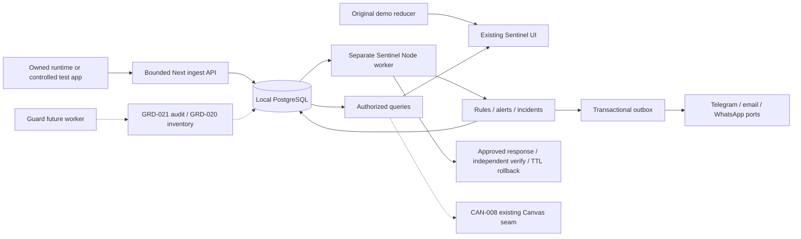

# Sentinel S00 architecture audit

**Current S01 finalization, 14 November 2026:** H01 provisioning, 14/14 real PostgreSQL acceptance, development up/up idempotency and the separate Windows private-IPC worker lifecycle retest passed. The owner explicitly authorized final review, commit, push and a PR to `master`; merging, deployment, new migrations, worker activation and S02 remain outside this task. The worker is stopped. See [current validation](SENTINEL_S01_VALIDATION.md) and [acceptance history](SENTINEL_H01_ACCEPTANCE.md). The preparation-stage status and S00 audit below are historical; their pending-H01 statements do not describe the accepted local instance.

**S01 status update, 14 November 2026:** this historical S00 audit/contract freeze is retained below. S00 merged at `ec6838b77cf14a126cb3c4d1a7f8d86d70d85665`; the owner's subsequent explicit S01 task authorizes platform implementation and SQL preparation only. See [S01 architecture](SENTINEL_S01_ARCHITECTURE.md), [migration review](SENTINEL_S01_MIGRATION_REVIEW.md), [H01 setup](SENTINEL_H01_SETUP.md) and [S01 validation](SENTINEL_S01_VALIDATION.md). H01 still blocks provisioning/connection and migration application. Historical statements below about absent DB dependencies/S01 scope describe S00, not the prepared S01 packet. Guard fixture/live boundaries and all ownership decisions remain unchanged.

Scope: architecture and contract alignment only, based on the complete 333-line `WetScan_Sentinel_Development_Playbook_v1.1_Guard_Aligned.md` supplied from Downloads. Its later packet prompts are reference material, not authorization to execute S01-S11. See [H10 compatibility sheet](SENTINEL_COMPATIBILITY.md), [packet backlog](SENTINEL_INTEGRATION_BACKLOG.md), [human actions](SENTINEL_HUMAN_ACTIONS.md), and [validation](SENTINEL_VALIDATION.md).

## Current evidence and compatibility

Audit baseline: local/remote `master` both `3f05e3cb70aaa7c21246dd6ae902635e57f463fb`, checked with `git ls-remote origin refs/heads/master` before edits. Clean initial tree; no repository/worktree/app created. Changes stay on `feat/sentinel-s00-contract-alignment` for PR review; no automatic merge. H10 is APPROVED with owner approval and owner-reported confirmation of Daud's approval, both dated 14 November 2026 (Asia/Jakarta), no amendments; see the compatibility sheet for provenance. S01 and PostgreSQL migrations remain out of scope.

- Next 16.4.6 / React 19.3.1 / TypeScript 6.0.3; Vitest 5.1.0 / Playwright 1.65.0 from installed manifest/lockfile. No PostgreSQL client/ORM in root dependencies; no dependency change in S00. Proposed S01 choice: small `pg` driver with parameterized SQL and a typed repository/migration layer, subject to H10 and current version/license review in S01. No ORM-generated schema synchronization.
- Guard contracts, adapters, pipeline, worker orchestrator, architecture/status/testing and merged integration backlog were inspected. Guard documents actual controlled Opengrep/Gitleaks/OSV/Trivy CLI verification; this is historical fixture evidence, **not rerun scanner/provider evidence in S00**, not customer scans. Domain rules and injected worker-port tests are implemented. Live snapshot grants, durable storage/queue, enforcing scanner sandbox, schedules and CI remain pending (GRD-001/003/004/005/019/022/023).
- Guard GRD-020/021 publishers return `not_integrated`. Their existing signatures lack enough provenance for live delivery. Future adapters must resolve actual scan, immutable repository commit and redacted evidence from trusted Guard persistence, then form versioned envelopes. Sentinel cannot invent this information or call fixture runners. `InventoryItem` is reused directly; null licensing remains unknown.
- Canvas's server reader and project service already check session/profile identity, onboarding, selected repository, current user access and App installation. It pins branch/commit/tree/blob hashes and rechecks revocation. Workspace scope includes GitHub user and workspace string. Canvas cache remains encrypted local storage; CAN-004 PostgreSQL is pending. CAN-008 remains unavailable. Existing docs record one local live GitHub repository acceptance; current S00 does not re-exercise that external provider.
- Existing auth/session/onboarding uses encrypted files with seven-day sessions and rotation; no DB migration or alternate OAuth flow. A request string/DTO is not a server grant. Future control-plane writes need existing cookie session/origin protection, current repository authorization and operation-specific consent; the read context added in S00 grants no response/scan rights.
- Sentinel currently has no live project route, API, DB, telemetry, detection daemon, response provider, delivery service or feed. Its UI/reducer and `src/services/adapters.ts` remain demo. GitHub source integration does not imply runtime monitoring. Some existing Manage/Settings copy still speaks of demo/no backend even though auth/source-backed Canvas exists; owner-owned copy harmonization is deferred to S10 rather than silently changing it here.

## Frozen ownership and route inventory

| Owner/surface                                                                    | Existing state                                      | S00 / later seam                                                                                       |
| -------------------------------------------------------------------------------- | --------------------------------------------------- | ------------------------------------------------------------------------------------------------------ |
| Auth/Daud: `src/lib/auth/**`, auth/onboarding routes, account controls           | Real auth and selected GitHub source boundary       | Read/reuse only. Existing authority called by new server mapper, no grant minting or store edits.      |
| Canvas: `src/features/canvas/**`, `/api/canvas/[projectId]`                      | Source-backed graph and scoped cache                | Read only; CAN-008 companion DTO/unavailable source under Sentinel. No graph engine.                   |
| Guard: `src/features/guard/**`, `worker/guard/**`, original Guard view           | Demo workbench, verified fixture tools/domain rules | Read/types reused only; original unavailable publishers retained. No scanner startup.                  |
| Prototype: demo provider/reducer/fixtures, app-shell, views, router              | Original Orderly visual experience                  | No edits. Future S04/S10 must preserve design, nested Ghost/Intelligence and explicit evidence labels. |
| Sentinel: new `src/features/sentinel/**`, `tests/sentinel/**`, `docs/SENTINEL_*` | S00 only                                            | Versioned types, authorization mapper, preflight validators, infrastructure interfaces and tests/docs. |
| Future platform/DB + Sentinel worker                                             | Not implemented                                     | S01 after H10/H01. No current `worker/sentinel` executable or daemon.                                  |

`src/app/app/[...path]/page.tsx` dispatches:

| Route                                                                                | Actual behavior                                                       | Future packet                 |
| ------------------------------------------------------------------------------------ | --------------------------------------------------------------------- | ----------------------------- |
| `/app/projects/github-<id>/canvas`                                                   | Source-backed authorized Canvas; only live project module route today | Preserve                      |
| `/app/projects/github-<id>/sentinel...`                                              | Not found today; no implicit demo fallback                            | S04/S10 owner route handoff   |
| `/app/projects/orderly-demo/sentinel` and `/activity`, `/incidents`, `/responses`    | Original demo overview, synthetic timeline stream/list/history        | S04 adapter integration later |
| `/app/projects/orderly-demo/sentinel/incidents/INC-<digits>`                         | Local incident detail; absent after reset/reload                      | S04                           |
| `/app/projects/orderly-demo/sentinel/ghost`, `/intelligence`                         | Nested demo screens                                                   | S07/S08/S09                   |
| `/app/notifications`, `/integrations`, `/reports`, `/settings`, `/activity`          | Shared demo presentation; account state handled separately            | S06/S10                       |
| `/`, `/demo`, `/onboarding`, `/login`, `/account`, `/app`, projects and Guard routes | Existing entry/account/project/demo behavior                          | Preserve; no auth/nav rewrite |

## Complete Sentinel and related action mapping

| Current action/control                                                                         | Current producer/state                                                               | Planned live producer / guard                                                                         |
| ---------------------------------------------------------------------------------------------- | ------------------------------------------------------------------------------------ | ----------------------------------------------------------------------------------------------------- |
| Six Sentinel tabs, incident links, component/finding/preferences links, review-incidents links | Navigation only; hardcoded Orderly project                                           | S04/S10 authorized project refs, no evidence creation by navigation                                   |
| Simulate suspicious request (`detect:api`)                                                     | Demo reducer creates INC-1042+, synthetic rule/timeline and channel previews         | S02 stored telemetry -> S03 rule match/alert -> S04 incident; explicit demo action stays demo         |
| Activity Pause/Resume and source filter                                                        | Local display state; hides/filters incident timelines; no ingestion pause            | S04 query/display filter; source pause must be separately authorized if added                         |
| Expand demo detection rules / evidence details                                                 | Static conditions/fixture text, synthetic timestamps/evidence IDs                    | S03 versioned rule records / S04 stored redacted evidence                                             |
| Evaluate policy & apply demo action (`advance`)                                                | Reducer accepts synthetic actor restriction, TTL descriptive only                    | S05 proposal -> scope/consent -> approval -> response adapter; no auto-enforcement                    |
| Request outcome verification (`advance`)                                                       | Local `verification_pending`                                                         | S05 independent bounded verifier job                                                                  |
| Select pass/fail/pending and run synthetic verification (`advance`)                            | Fixed replay 429/control 200 or failure; pending creates no proof                    | S05 observed replay AND benign control; failed/inconclusive stay explicit                             |
| Roll back restriction (`rollback`)                                                             | Synthetic timeline/state                                                             | S05 idempotent rollback + worker TTL expiry; historical verification not current enforcement          |
| Close investigation (`close`)                                                                  | Changes case status, separate from effectiveness                                     | S04 audited close reason; no neutralization inference                                                 |
| Archive & propose draft (`archive`)                                                            | Marks archived; candidate RULE-CAND-02 becomes draft                                 | S08 internal case with evidence; DRAFT rules require review                                           |
| Ghost setup/review modal, enable switch, Save config (`ghost`)                                 | Local enabled flag; no endpoint deployed                                             | S07/H07 approved harmless placement and scoped source config                                          |
| Test decoy (`detect:ghost`)                                                                    | Synthetic GHOST-03 event/incident; router opens it; disabled when off                | S07 actual controlled hit through same S02 pipeline, test source label; false positives possible      |
| Adaptive isolation button                                                                      | Disabled roadmap                                                                     | Deferred; not authorized by any current packet                                                        |
| Case library/external advisories tabs                                                          | Local tab state; archived demo cases vs fictional ADV-009                            | S08 real internal cases separate from S09 external knowledge                                          |
| Review draft, inspect evidence, check confirmation, approve (`rule`)                           | Human checkbox; approves demo only                                                   | S08 reviewer/audit/validation; never AI auto-publish; live rejection/enabling planned                 |
| Re-evaluate exposure (`reevaluate`), linked FIND-103                                           | Toggles fictional inventory display; no feed                                         | S09 actual version inventory + timestamped advisory, repository potential only                        |
| Notification enable, destination, trigger choices (`channel`)                                  | Local preview configuration, no credentials/provider                                 | S06 channel config with destination consent; H04/H05/H06                                              |
| Test preview (`preview`), modal dismiss, log filter                                            | Local message, provider ID/delivery null                                             | S06 explicit test-send plus outbox/ledger; accepted != delivered                                      |
| Quiet-hours toggle (`preferences`)                                                             | Preference only, no scheduler                                                        | S01/S06 worker scheduling; explicit timezone                                                          |
| Integrations provider links; runtime/AI/channel links                                          | Navigation to existing onboarding/demo/settings; source/provider categories distinct | Preserve source auth; runtime H02 and notification H04-H06 independent                                |
| Staging form URL/paths/rate/consent save (`staging`)                                           | Fictional HTTPS `.test` only; no DAST request                                        | Guard-owned scope execution; not Sentinel scanner functionality                                       |
| Reports copy/print and incident links                                                          | Current synthetic summary/browser clipboard/print                                    | S10 scoped source-stamped report; no certification                                                    |
| Settings theme, name (`project`), retention Save (`preferences`)                               | Local appearance/name/preferences; no durable cleanup                                | S01 retention policy plus S10 settings handoff; no auth workspace rename here                         |
| Shared Reset demo, help modal and theme switch                                                 | Existing reducer/reset/appearance; no live data mutation                             | Preserve; reset never deletes live persisted records; CAN-017 cross-Canvas edit reset remains pending |

## Target architecture (future, not running)

Use a modular monolith: Next routes for bounded ingestion/control/query, separately launched Node worker for durable timers/jobs. No Redis/broker/Kubernetes/new backend. Sentinel does not execute scanners or target-repository code. Ghost uses the same runtime pipeline. Public advisories can sync without Guard; exposure mapping waits for actual observed inventory.

## PostgreSQL and durable infrastructure design for S01 review

This section describes ownership and semantics, **not SQL schema/migrations**. H10 must precede creating any DB schema file.

- One local development PostgreSQL instance. Propose module-owned `sentinel` records, module-neutral `platform` jobs/outbox and migration ledger. Auth files and Canvas graph cache are untouched. No Guard tables or data migration. Sentinel project binding uses the existing authorized selection; a metadata binding cannot grant access. Avoid schema search-path assumptions and use qualified names.
- Logical records: project binding; telemetry source and hashed/rotatable ingest credentials; security events; versioned rules/matches/alerts; incidents/append-only timelines; approved response/verification; notification channel/outbox/attempts; decoys; archived cases/candidate rules; advisories/exposures/feed runs. Add only the active packet's tables. No executable rule payloads, raw secrets, auth tokens, passwords, full request bodies or raw IPs in evidence/jobs.
- Every module record, unique constraint and reference uses `(mode, workspaceId, projectId)` plus record ID; source event dedupe adds `sourceId + producer eventId`. Inventory/audit dedupe adds producer/category/idempotencyKey. Compound FKs prevent cross-project evidence references. Scoped queries must check current authority, not just possession of an ID. Store revision numbers for optimistic concurrency; commits are separate immutable source versions. Store UTC timestamps; display WIB.
- Atomic event accept + durable job enqueue; atomic rule match/alert/incident/timeline + outbox append. A rollback commits none. Duplicate key with identical canonical payload returns original receipt; same key/different payload is conflict, never overwrites evidence. TransactionContext in `platform-contracts.ts` is an interface, not a transaction implementation.
- Claim with short PostgreSQL transactions and `FOR UPDATE SKIP LOCKED`, module-specific eligible rows, lease expiry and fencing token. Persist attempt count, availableAt, bounded exponential backoff + jitter, cancellation and dead-letter state. Expired leases are reclaimable; old lease/revision cannot heartbeat/complete after reclaim. Provider I/O happens outside DB locks. Retries are **at least once**; consumers/provider idempotency and uniqueness avoid duplicate effects where supported. Do not promise exactly-once external delivery after a crash between send and receipt persistence.
- Outbox entries are committed alongside domain changes, then leased through the same durable mechanism. Track each provider attempt separately, redacted failure/acceptance/verified callbacks; API acceptance is not recipient delivery. No notification jobs from demo/fixture state. Worker restart reclaims jobs/TTL rollbacks without relying on Next rendering, request timers or in-process arrays.
- Separate module queues/roles and worker processes. Sentinel claims only `module=sentinel`; future Guard job scheduling/storage adapter can reuse interfaces but remains behind its own tests and approval. Guard scanners must not receive Sentinel DB/provider credentials. Guard snapshot, sandbox, engine allowlist, global scanner resource limits and cancellation enforcement remain Guard/platform work, not solved by a queue DTO.
- Proposed local Sentinel budget in H10 sheet; bound per-project fairness, global concurrency, response TTL/retry and source rate limits separately. Proposed retention for review: raw events 7 days, derived evidence/attempts 30 days; preserve evidence linked to open incidents, audit approved changes, batch deletion and avoid orphan refs. Demo retention selector is not a live policy. Index conceptual access paths: scoped source/event dedupe, incident time/status, eligible module/job availability/lease, outbox dedupe/attempts, advisory aliases. Validate indexes/retention and permissions in S01/S11.
- S01 tests required: migration twice/upgrade rollback strategy, DB roles, two-project/mode isolation, atomic rollback, duplicate/conflicting enqueue, concurrent claims, restart/reclaim/fencing, persisted cancellation, outbox crash boundary, backoff/dead-letter, TTL recovery and retention. These have **not** run in S00. Health distinguishes DB connectivity, worker heartbeat, queue lag and configured sources; HTTP 200 alone never means monitoring works.

## Versioned contracts and remaining integration work

`types.ts` defines source-aware event/alert/incident/timeline/response/verification and notification DTOs. `contracts.ts` reuses Guard Scope/InventoryItem/publish payload and Canvas interface by type; `platform-contracts.ts` is a future transaction/job/outbox interface only. `server/project-context.ts` reuses actual Canvas authorization. `scope.ts` isolates namespaces and dedupe keys. `integrations.ts` offers internal preflight checks and explicitly unavailable seams; nothing is mounted in routes/UI/workers.

Preflight checks reject wrong scope/mode/revision, missing grant permissions/expired grants, missing scan/commit/evidence provenance, fixture/demo origins, unmapped Canvas node IDs and cross-project links. Guard observed scan evidence is distinct from runtime telemetry; controlled test evidence remains labeled. Trusted producer proof must come from future real storage after current repository reauthorization; the validator cannot authenticate a caller-supplied proof. Strict unknown-JSON parsing, payload bounds/redaction/rate limits and persistent dedupe are future endpoint work, not supplied by TypeScript or these typed internal validators.

The live lifecycle is `ingested -> normalized -> rule_matched -> alert_created -> incident_opened`, with independent response proposal/approval/apply/verify/rollback/expiry and case close/archive. A case may close without action. Apply is not verify, archive/close is not neutralization, advisory/release decision is not attack. Optional AI produces untrusted explanatory drafts only; external provider configuration and network enablement remain human decisions.
