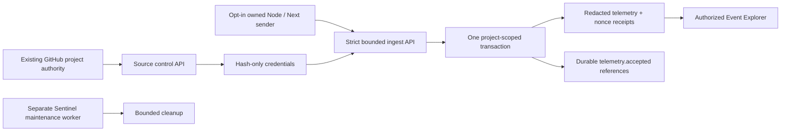

# Sentinel S02 telemetry implementation

## S02 final review and publication authorization - 15 November 2026

The owner explicitly approved final S02 review, commit, push and a PR targeting master in this conversation. No merge, migration, deployment, production change, worker activation or S03 is authorized. All55reviewed files remain in approved S02 scope: authenticated telemetry/source lifecycle, strict ingestion/redaction/idempotency, additive0002SQL, isolated maintenance retention, opt-in sender, existing-UI integration and scoped test/documentation evidence. Existing Auth/Guard/Canvas, frozen contracts, original shared dispatcher and Demo body remain unchanged; the reviewed AppShell links and Sentinel wrapper are the narrow S02 integration. Latest origin/master fetched at e39b01da167052b8ef9b0ebe369a757fdea729bf, identical to branch base; no conflict or unrelated change found. No dependency/lockfile change.

Fresh finalization checks: typecheck PASS; ESLint PASS; complete unit/contract suite489/489PASS in33files,10.27s; production build PASS with private dotenv loading disabled; unchanged original browser regressions6/6PASS in one standalone3.3minute run; unchanged mocked-transport telemetry browser suite5/5PASS in23.1s. All exits0; no retries, timeout changes or assertion weakening. Original first case59.1s against60s remains a timing limitation; Next reported slow OneDrive filesystem. Browser evidence is fixture-based and separate from prior genuine H02. Existing PostgreSQL TEST suites, H02 HTTP/DB/UI/credential/restart and worker lifecycle were NOT RERUN. No DB connection/migration or main worker/emitter/scanner started in finalization. Existing H02 keys remain revoked/source disabled/runtime approvals closed.

Review corrected one documentation overstatement: the production Load older events button has not been browser-tested; actual API cursor pagination passed and remains distinct. No implementation, migration SQL or permission change, so prior PostgreSQL/H02 acceptance remains applicable. Retained helper/date-input failures stay visible. No raw private database snapshots, credentials, passwords, tokens, local approval/env files or runtime artifacts are included. Final private-argument scans and staged-manifest/whitespace checks precede commit; raw evidence remains ignored.

GitHub read-only checks: master unprotected, protection endpoint404, active branch rules empty; no configured required status checks. No GitHub Actions workflow directory exists in this checkout. Available PR/commit checks will be queried after push/PR; do not interpret absence of enforced checks as independent review approval. No manual Vercel deployment or cloud PostgreSQL configuration is permitted. Commit SHA/PR URL and live check results are reported in the final publication response and PR, not invented in this pre-commit document.

## Prior H02 acceptance and approval-gate record (historical)

**Current H02, 15 November 2026 (Asia/Jakarta): COMPLETE for bounded local controlled-test integration.** Owner explicitly changed the approved target from wilanta/wetscan-prototype to owned wilanta/portfolio (github-998736528). Real interactive GitHub login and fresh existing Auth/Canvas authority verified; workspace github-user-187839747:test. Exact approved wetscan_dev/marker/plan and unchanged prior catalog/data/roles verified before activation. One local/controlled_test source,8persisted events,6receipts and8queued accepted-job references retained. Real HTTP, PostgreSQL, Event Explorer, credential lifecycle, isolation and app-restart evidence passed. Both keys revoked, source disabled, emitter opt-ins zero, runtime approval consumed/closed; app/main-worker/emitter/capture/scanner processes stopped, listeners3000/3112/3113 zero. No migrations, TEST access, production, S03 or publication. Prior489units/typecheck/lint/build,6original-browser/5telemetry-browser and PG-suite evidence are historical, NOT RERUN. S02 is ready for final review; commit/push/PR requires separate owner approval. [Actual H02 evidence](SENTINEL_S02_VALIDATION.md), [handoff](agent-handoffs/HANDOFF_S02.md).

## Earlier status and preparation evidence (historical)

**H02 update,15 November2026:** owner approved the bounded stop/loopback restart. Old PID12652 stopped after identity verification; existing app PID22180 successfully served only127.0.0.1:3000 at existing APP_URL localhost:3000, then stopped. Root/login/onboarding200 and unauthenticated Sentinel control401 checks passed; no code/build change. Real existing GitHub login reached its interactive sign-in form: H02 now BLOCKED_AUTHENTICATION pending owner sign-in/repository selection, with actual Auth/Canvas authority still unverified. No H02 DB runtime approval/env/source/key/event or DB connection. Final listeners3000/3112 and worker/emitter/Guard-worker matches0. Offline plan unchanged; historical database/static/browser evidence not rerun. [Current handoff](agent-handoffs/HANDOFF_S02.md).

## Previous development-migration status (historical)

**Current S02,15 November2026:** Owner-approved development0002 migration and identical second up PASS(exit0/0), exact wetscan_dev target/marker and combined plan verified. Four empty telemetry tables,7indexes,8FORCERLS policies and approved privileges verified; S01 schema/data/heartbeats and existing role grants unchanged. No TEST connection or runtime activation. Separate migrate_up-only record consumed/closed; previous approvals untouched. H02 actual owned-app/configuration/web-emitter activation and PR publication remain WAITING_USER; S02 not complete. Prior TEST/static/browser passes preserved, not rerun. [Actual migration and acceptance](SENTINEL_S02_POSTGRES_ACCEPTANCE.md), [handoff](agent-handoffs/HANDOFF_S02.md).

## Historical preparation and initial acceptance record

Status: implemented for review; NOT COMPLETE. Master baseline `e39b01da167052b8ef9b0ebe369a757fdea729bf`, branch `feat/sentinel-s02-telemetry`, uncommitted. On15 November 2026 owner-approved TEST-only PostgreSQL acceptance passed preflight and up/up/empty0002-down/up:14 S01 PASS;14 S02 PASS,1 pagination FAIL,3 NOT RUN; stopped with fixtures retained. [Actual report](SENTINEL_S02_POSTGRES_ACCEPTANCE.md). No development connection/migration, main worker/emitter, fix/retry, commit/publication or S03. Narrow existing-UI integration remains explicitly authorized by the S02 request; original ownership boundaries remain.

## Authority and flow

Existing `wetscan_session` -> existing Canvas identity/workspace derivation -> fresh `authorizeSentinelProject` -> scoped platform transaction -> existing project binding. No alternate OAuth, repository registry, account storage or workspace ID is introduced. Workspace remains `github-user-<id>:<workspace>`; project remains `github-<repository id>`; Canvas ref remains `github-user-<id>/github-<repository id>`. Renaming a workspace changes scope; migration/transfer remains a separate human decision. Control endpoints call the existing authority on every request; write origin checks reuse Auth. They do not acquire a second Auth exclusive lock.

The server generates a source UUID, fixed environment/provenance and a scoped credential. Ingestion decodes credential routing hints, selects that source under RLS and a source row lock, and authenticates the complete credential against the stored hash. A producer project field is a consistency check only; it never grants access. Source and project binding must be enabled. Runtime credentials are independent delegated capabilities: losing GitHub repository access prevents source control/read but does not automatically revoke an already issued sender key. The owner must revoke/disable it or disable the project binding. No new repository-revocation synchronizer is claimed.

Queue references are a **future S03 seam**, not a running detection pipeline. No detection handler, alert, incident, Ghost endpoint, response, external provider, Guard scanner or Guard enrollment is implemented. The Sentinel worker continues claiming only `sentinel.maintenance`. Guard files/worker and frozen S00 contracts remain unchanged.

## Database and transaction contracts

`0002_telemetry` adds only four `sentinel` tables: `telemetry_sources`, `telemetry_credentials`, `telemetry_batches`, `telemetry_events`. All keys include mode/workspace/project/source; source credentials and records reference their source, and sources reference the existing project binding. Sources have immutable environment/provenance; management changes enabled state, credential revocation and revision. Event IDs are unique per source, not globally across unrelated producers. UUIDs are server-generated for sources/credentials; producer batch/event UUIDs are strictly validated.

All tables ENABLE and FORCE RLS. `wetscan_app` reads/writes only its transaction's live Sentinel workspace/project. It cannot delete telemetry. Worker SELECT/DELETE is limited to source metadata and events/receipts; the worker has **no credential grants** and no source modification grant. Its existing Sentinel role is intentionally trusted across Sentinel projects for bounded maintenance; it is not a tenant-facing credential. Migration ownership permits DDL and SELECT for safe reversal, not unrestricted runtime insertion. Guard permissions are not expanded.

Ingestion serializes on source, validates stored credential/revocation and DB-clock windows, then locks the existing binding before project-wide capacity checks. The redacted event, event fingerprint, batch receipt, source timestamps and durable accepted-job reference commit atomically. Conflicting event/nonce content or enqueue/rate/cap failure rolls back the entire batch. Duplicate event content adds no second event/job. Exact nonce retry returns the original receipt within the clock window; a new nonce containing an existing event returns an event duplicate receipt. Fingerprints intentionally cover **normalized redacted content**; discarded private data never participates in persisted hashes. Reusing a nonce with changed normalized content is 409. Rate accounting also counts valid retries, protecting database work.

Project event queries are parameterized and RLS-scoped, ordered by `(ingested_at, source_id, event_id)` descending. Cursors bind scope, selected filters and a fixed time window; SQL formats the cursor timestamp with all PostgreSQL microseconds, avoiding JS millisecond truncation. Query results match frozen `StoredSecurityEvent` with source-bound evidence/provenance. Severity is an untrusted hint, never an alert result.

## Security and resource bounds

| Boundary | Implemented choice |
| --- | --- |
| Credential | `ws2.<base64url route>.<256-bit random hex secret>`; SHA-256 of whole token; timing-safe digest comparison; routing hints grant nothing |
| Lifecycle | Create/rotate return plaintext once over no-store response; rotation revokes all prior active credentials in the same locked transaction; revoke all; disable rejects ingest; enable does not revive revoked keys; no retrieval endpoint or token expiry claim |
| Body | JSON only; 64 KiB streamed bound; 4 KiB control writes; no compressed bodies; fatal UTF-8 decoding; five-second incomplete-body timeout |
| Events | Four v1 families only; 1–25 events; strict known envelope/event/request/attribute keys; valid UUID and UTC ISO timestamps |
| Clock | Inclusive DB-clock past five minutes/future thirty seconds for sentAt and every event; older retries rejected even if a receipt exists |
| Admission | Bounded process counter 1,500 ingest requests/minute, including invalid attempts; additional durable per-source event rate 1–6,000/minute (default 1,000) |
| Storage | 100 sources/project; 100 lifetime credential records/source; 100,000 events/project; 10,000 nonce receipts/project; inherited maximum 1,000 queued/leased jobs/project |
| S03 backpressure | Accepted jobs remain queued; at 1,000 pending jobs, new events fail 429 atomically. Do not fabricate a consumer, silently discard jobs, or disable backpressure to keep ingesting |
| Retention | Source event retention 1–30 days, default seven; receipts one day; each maintenance pass <=100 events and <=100 receipts/project; legal hold respected; queued/leased evidence references pin events |
| Query | Default last 24 hours; max 31-day query window; limit 1–100 (default 50); filter/cursor bounded and validated |

Redaction strips route queries/fragments; only a small static segment allowlist is retained and every other segment becomes `:redacted`, including sender-supplied parameter names. Raw actor identifiers and even supplied actor hashes are discarded. Request data is limited to approved method, redacted route and integer status. Attributes retain only allowlisted `reasonCode` and bounded numeric `durationMs`; unknown reason values become `redacted`, unknown keys are rejected. A supplied `controlled` Boolean is discarded: provenance is the registered source's value. No headers, cookies, request bodies, IPs, emails, stack traces, arbitrary messages or exception text are stored/logged by this pipeline. Source names are bounded human labels; operators must not put secrets in names.

No global Internet rate gateway, multi-host admission service, TLS exposure or production deployment is configured. The reference emitter explicitly permits loopback HTTP only, refuses redirects/URL credentials and requires two opt-ins. Hosted application integration will need a separately approved HTTPS transport/exposure design. Existing application Auth/routing/Canvas/Guard ownership is preserved.

## Existing UI integration

The original Sentinel component delegates to a new telemetry panel only when an authorized GitHub project ID is supplied. Existing demo body, reducers, fixtures and simulation actions remain intact. A narrow server route serves `/app/projects/github-<id>/sentinel`, `/activity`, `/sources`; its Orderly Demo fallback preserves every original demo subroute. The original shared catch-all is unchanged. Sidebar links retain the live repository between Canvas and Sentinel; Guard/Ghost/Intelligence still lead to clearly identified demo surfaces. No live incident/response route is invented.

Sources offer create/list/refresh/rotate/revoke/disable/enable and genuine contact timestamps. Event Explorer offers source/kind/severity/time filters, fixed-window pagination, redacted detail and optional visible-tab polling every 15 seconds. Filter edits are debounced 150 ms and obsolete requests are aborted. The one-time credential exists only in component memory and is cleared on dismiss/action/navigation; it is never put in browser storage or query strings. Runtime source provenance is labelled source-declared; controlled tests and Orderly Demo remain distinct.

Connectivity uses DB timestamps: no credential/contact -> not configured; accepted contact within two minutes -> connected; <=15 minutes -> stale; older/disabled -> disconnected. Exact nonce retries do not refresh contact; new accepted batches do. Connectivity establishes receipt, not protection. For compatibility, the S01 worker health response retains `telemetry=not_implemented`; the worker does not process telemetry/detection jobs and that endpoint does not probe the web ingest API. Source API/UI status measures telemetry receipt. This legacy health field is a reporting limitation, not evidence that the web ingest API has been tested or is operational. A clearer versioned health capability contract can be reviewed with S03.

## Validation and activation

See [validation](SENTINEL_S02_VALIDATION.md), [exact migration review](SENTINEL_S02_MIGRATION_REVIEW.md), [H02 procedure](SENTINEL_H02_SETUP.md), and [self-contained handoff](agent-handoffs/HANDOFF_S02.md). Existing S01 private approval hashes deliberately fail for the combined S02 plan. No automatic migration is performed during web/worker startup. Do not update approval files until the owner approves the new exact target/actions/hash.
