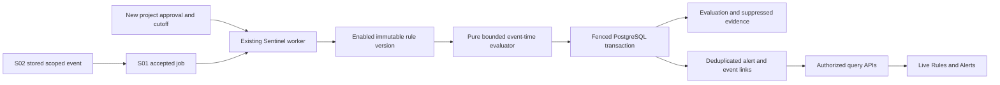

# S03 deterministic detection and durable alerts

Prepared on `feat/sentinel-s03-detection-alerts` from verified merged S02 `cd313ce29aeac865e15cea9abd9c412cb9c2c3cc`. Bounded actual H03C-2 DEV acceptance is now verified below; no production monitoring is enabled. No S04 incidents, response, notification delivery, new Ghost endpoints, scanners or Intelligence sync.

## Contracts and ownership

`detection/model.ts` adds strict v1 definitions and alerts without rewriting frozen S00 types. Rules carry live mode/workspace/project identity, UUID, immutable version/current revision, lifecycle, actor/timestamps, category/severity/confidence and bounded predicates. Only DRAFT, ENABLED and DISABLED are used. Existing Auth/Canvas authority derives each API scope; identifiers supplied by clients never grant it.

Create starts DRAFT. Enabled rules must be disabled before editing. Edit creates a new DRAFT version; enable/disable also append versions and actor audit. Expected revision is mandatory. No version or audit UPDATE/DELETE grants exist. Enabled historical definitions remain referenced by alerts. Rule management does not silently enable a disabled project binding.

Eight new tables: detection_rules, detection_rule_versions, detection_audit, detection_evaluations, detection_alerts, detection_evidence, detection_cooldowns, detection_suppressed_evidence. All are Sentinel-owned with FORCE RLS and composite scope-aware keys. A deferrable current-version FK permits atomic creation without dangling current definitions. Evidence references actual S02 event rows with restrictive FKs. No Guard/Auth/Canvas SQL or credentials.

## Event-time policy

The diagram describes the implemented pipeline. Historical H03B/H03C-1/H03C-2 approvals and observed acceptance are recorded below; no new runtime activation is authorized by this document.

Version 1 uses UTC epoch-aligned tumbling buckets, not a rolling-window claim: `[floor(eventTime/window)*window, start+window)`. Threshold is unique matching source events in that bucket. Rules A/D five-minute examples therefore do not correlate across a bucket boundary. Maximum window 3600s, threshold/candidate set 500, eight AND predicates; no arbitrary expressions, SQL, regex or unknown event fields.

Correlation includes project, source and registered origin. Actor correlation is rejected on enable: S02 deliberately discards all actor identifiers/hashes. Rule A remains an explicit unsupported DRAFT; no guessed attribution or source-wide replacement. Rule B requires `http.suspicious_path` plus normalized reasonCode=suspicious_path. Rule C accepts decoy wire events preserving controlled_test; installation/attack success is unproven. Rule D counts normalized HTTP statuses >=400, not IP/path/user-agent evidence.

Late admission uses stored ingestion time: at or before bucket end +300s is accepted, later is audited late_event. Worker delay is irrelevant. New versions evaluate only events ingested at/after their explicit enable timestamp; no automatic replay. Window queries are deterministic and scope/source bounded. Overflow fails explicitly, never truncates to a passing result. Stable match identity includes exact rule version, scope, source/correlation and bucket; evidence orders by event time/source/ID. Conflicting duplicate references fail.

## Durable processing and suppression

Existing S01 executor supplies the current renewed lease. Effects lock the project binding then the active job; token/owner/expiry/cancellation validation occurs before writes and again before commit. Revision is allowed to advance through the same token's heartbeat; a replaced token cannot write. Existing executor acknowledges after commit. Persisted per-event/per-version evaluations and unique alert deduplication keys survive acknowledgment loss and process restart. Stale/cancelled/failed attempts roll back, and fixed errors enter the existing bounded retry ledger. No provider I/O occurs under locks.

An alert represents a matched rule, not confirmed intrusion. Repeated matching events in the same bucket update count/bounds and append evidence to one alert. Explicit UTC suppression windows affect detections anchored inside `[from,to)`; the underlying monitoring/count window continues, so a later unsuppressed anchor may use events from that bucket. Database-clock cooldown suppresses new bucket alerts for the same rule-version/source/correlation; existing alerts can gain evidence. Version changes create new cooldown identity. Suppressed matches retain outcome/reason and restrictive evidence links, distinct from S06 notification quiet hours. Default suppression/cooldown configuration requires explicit rule enable by the owner.

## Worker activation and retention

Disabling/revoking a source prevents new ingestion; it does not erase or implicitly cancel already accepted jobs within a newly approved processing scope/cutoff. Project disable or explicit queue cancellation revokes processing. The eight historical H02 jobs remain excluded by cutoff. No replay interface or activation bypass is implemented; a future historical replay needs its own reviewed plan and authorization.

Use the existing separate Sentinel process; never Guard jobs. Detection is default off and needs both explicit environment opt-in and a new private runtime approval extension binding one live project and new-job creation cutoff. The approved target and full plan must still validate through existing pool checks. Queue filtering is a minimal backward-compatible shared extension because the old kind-only claim API could consume historical jobs; expired-attempt housekeeping is filtered too. No frozen contract change or competing framework.

S03 derived retention is 30 days with legal hold and pending-job preservation. Release suppressed links before expired evaluations, then alert evidence before expired alerts; delete at most 100 evaluations/100 alerts/100 cooldowns per pass. Rules/versions/audit are retained. S02 retention additionally skips actual alert/evaluation/suppressed references; FKs independently prevent orphan deletion. Older S02-only code confronted with referenced evidence fails safely. Pending jobs still pin events. Derived retention is not authorization to delete historical evidence during preparation or acceptance.

Bounds: 25 rules/project, 100 versions/rule, 500 candidates/evidence per rule-window, 10,000 alerts, 100,000 evaluations, 50,000 suppressed evidence links/project. Capacity exhaustion rolls back and retries within the existing five-attempt budget; it does not become a clean no-match. Existing module concurrency two, pool three, timeouts and 256MiB old-space ceiling remain. This is not an OS RSS/CPU sandbox.

## UI and compatibility

Narrow live-only rules/alerts routes reuse the Sentinel wrapper/design system. Shared dispatcher, original Demo body/fixtures, Auth, Guard, Canvas and Guard worker are untouched. UI reads real API lists/details, supports explicit drafts/revisions/enable/disable, severity/rule/source/time filters and cursor pagination. Fixture browser tests prove UI behavior, not real persisted acceptance. Worker health adds explicit detection activation and unprobed web-ingestion fields while retaining legacy platform fields; it never claims production monitoring from database connectivity.

One tooling correction ignores already-private `.local/sentinel/**` in ESLint; an existing S02 publication helper otherwise caused two lint errors. The helper/history is preserved. See [validation](SENTINEL_S03_VALIDATION.md) and [migration gate](SENTINEL_S03_MIGRATION_REVIEW.md).

## H03C-2 observed acceptance — PASS, 15 November 2026

Owner source: attachment `21c4ae8f-54a6-4f86-a688-4d0ef7ffaa8a`, controlled real end-to-end acceptance. Authorization covered isolated local DEV runtime and NEW controlled-test records only. No TEST connection, migration, grant/role/container/volume/marker change, historical replay, scanner, emitter, external delivery, publication or S04 operation occurred. Earlier phase reports below retain their original time-specific status; this section is the current result.

### Isolation and preflight

Phase A completed before runtime writes: default-off acceptance mode requires agreement between the private approval extension and `SENTINEL_ACCEPTANCE_ISOLATION=1`, detection opt-in, exact DEV identity/plan/worker role/project/source, eight protected job identities, 1–12 distinct new admitted job IDs, a historical baseline fingerprint and an expiry no later than ten minutes after approval. Missing, malformed, contradictory or expired opt-in fails closed. Scope and IDs are cloned/frozen. Before even a new heartbeat, actual read-only PostgreSQL verifies all admitted/protected rows, state, module/kind, exact source, cutoff, DB clock expiry, and heartbeat-ID noncollision.

The queue appends exact-ID and database-clock expiry predicates to claims, lease-expiration housekeeping, attempt insertion and settlement, heartbeat, retry, cancellation and related outbox updates. Existing scope, module, kinds, fencing, token, revision, lease and role checks remain. Acceptance cannot enqueue. All acceptance retention is skipped, including global old-heartbeat retention, infrastructure/outbox, detection/telemetry and binding cleanup. Normal mode retains normal maintenance. Failure or expiry requests shutdown. A parent watchdog also bounded each real worker start to 180 seconds.

Source creation revealed an additional historical write path: re-enrolling the identical enabled actor previously incremented the existing binding revision/updated_at. The conflict UPDATE now runs only when enabled state or actor actually differs, preserving the existing row for identical identity while retaining the lock. Actual DEV source/rule creation and final full-row comparisons verified the original binding, revision and NULL cleanup timestamp unchanged. This changes Sentinel enrollment only; Auth/Canvas authority remains unchanged.

Read-only preflight matched the entire H03C-1 snapshot: PostgreSQL 17.12/170012, `desktop-linux`, container `wetscan-sentinel-local-postgres-1` (ID `0220e86e719aa43c30dfd3ba371e290de0fe9141d8d1fe7f7fc6a58accb8961f`), approved immutable 17.12 Bookworm image, volume `wetscan_sentinel_s01_dev_20261114`, loopback `127.0.0.1:55432`, database `wetscan_dev`, marker `wetscan-s01:26b6b537-c016-4dc7-8007-4e839e8b838f`. All three ledger entries/checksums/timestamps, 20 tables, 39 indexes, 38 policies, restricted roles/grants and FORCE RLS matched. Independent offline Node/Python hashing reproduced plan `c3e39f6fd43ee6eb2fbf5b244778955aab4cabb8a11ed3c66d791cf99a252a94`; no SQL changed. The existing DEV backup was read from its actual private record, remained 59,222 bytes / `ecfc51029a680a8d7b96b78f4f43c68fa09c9bb783b2a1431bebc28a241952e9`, and offline archive listing returned 12 TABLE DATA entries. No restore occurred. No unexpected listeners or consumers preceded startup.

### Acceptance outcome and boundaries

Actual authenticated pipeline and two controlled_test alerts passed. All 33 old rows and catalog/grants/RLS remained unchanged; 58 new rows are retained. Only NEW resources were disabled/revoked; both workers are stopped and five new approvals closed. 620 unit/contract and 17 browser fixture cases passed, separately from real DEV observations. See SENTINEL_S03_VALIDATION.md and the neutral handoff for exact IDs, lifecycle/health, preserved failures and limitations. No SQL or permission change accompanied isolation; the migration plan remains unchanged. Platform health retains legacy foundation/telemetry labels despite independently verified ledger and HTTP ingestion. No native credential TTL, actor correlation, incidents, notification provider or response integration was added.

## Guard G01 combined publication compatibility

The existing S03 branch safely fast-forwarded to approved Guard G01 master 12b843e2dfda82b3d806625983836fe2ada9ce0f after verified recovery-copy preservation of all 51 files. Optional Guard coverage fields preserve imported scope/audit/inventory types. Separate schema plans, credentials, workers and job admission remain. Guard code/proposed SQL was neither modified nor activated. The shared executor retains legacy two-argument JobHandler; additive LeaseAwareJobHandler gives Sentinel detection the latest fencing lease without requiring Guard wrappers to change. This type-only fix and two S03 regression cases resolve the observed combined typecheck error. Fresh combined checks pass: 680 unit/contract tests and 60 browser fixtures, plus typecheck/lint/build. Prior PostgreSQL and actual authenticated DEV evidence remains historical, not rerun. See validation/handoff for failures, exact baseline and publication gate.
