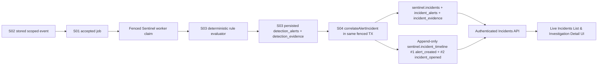

# S04 durable incidents, evidence and investigation timeline

Prepared on `feat/sentinel-s04-incidents` from verified merged S03 master `f7bfeef29488c3f997e9444555039514f55fa0a3` (PR #6). Current status: **IMPLEMENTED_PENDING_ACCEPTANCE**. No S04 database migration has been applied to TEST or DEV, no live worker has been started, and no production monitoring is enabled. No S05 response execution/verification, S06 external notification delivery, S07 Ghost deployment, or S08/S09 Intelligence sync is implemented or activated.

---

## 1. Contracts, Ownership, and `LifecycleEvent` Semantics

`src/features/sentinel/incidents/model.ts` defines concrete persisted S04 incident and timeline models (`SecurityIncident`, `IncidentTimelineRecord`, `IncidentPage`, `IncidentDetailRecord`) extending the frozen S00 `Incident` and `TimelineEntry` interfaces in `src/features/sentinel/types.ts` without modifying any frozen S00 contract file.

### Static Semantic Audit of `LifecycleEvent` (`policy_evaluating` vs `incident_opened`)

During S04 static architecture review, we audited how human investigation transitions (`open -> investigating` and `closed -> investigating`) map onto the frozen `LifecycleEvent` union in `src/features/sentinel/types.ts`:

```ts
export type LifecycleEvent =
  | "ingested"
  | "normalized"
  | "rule_matched"
  | "alert_created"
  | "incident_opened"
  | "policy_evaluating"
  | "response_proposed"
  | "human_approved"
  | "mitigation_applied"
  | "verification_pending"
  | "neutralization_verified"
  | "verification_failed"
  | "verification_inconclusive"
  | "rollback"
  | "expiry"
  | "incident_closed";
```

- **Semantic Mismatch Identified**: In Sentinel's architecture (`docs/SENTINEL_ARCHITECTURE.md` line 73 and `src/domain/types.ts`), `"policy_evaluating"` belongs to the **S05 response pipeline** (`policy_evaluating -> response_proposed -> human_approved -> mitigation_applied`), representing evaluation of an automated or operator-approved mitigation policy (such as `temporary_rate_limit`). Emitting `"policy_evaluating"` when a human operator starts or reopens an investigation in S04 would falsely imply that a response policy evaluation is running.
- **Smallest Backward-Compatible Correction Implemented**:
  1. `src/features/sentinel/types.ts` remains 100% untouched (`no-touch` frozen S00 contract).
  2. `IncidentTimelineEventType` (`src/features/sentinel/incidents/model.ts`) and the PostgreSQL `CHECK` constraint on `sentinel.incident_timeline.event_type` (`migrations/sentinel/0004_incidents.up.sql`) are restricted strictly to the S04-owned incident lifecycle subset:
     `"alert_created" | "incident_opened" | "incident_closed"`.
  3. Transitions into an active (non-closed) incident state (`null -> open` on initial alert correlation, `open -> investigating` on `investigate`, and `closed -> investigating` on `reopen`) record `event_type = 'incident_opened'`, while closing (`open | investigating -> closed`) records `event_type = 'incident_closed'`.
  4. Every timeline row persists explicit `from_status` (`null | 'open' | 'investigating' | 'closed'`), `to_status` (`null | 'open' | 'investigating' | 'closed'`), `actor_type` (`'system' | 'user'`), `actor_id`, `summary`, and `metadata.action` (`"investigate" | "reopen" | "close"`), and `LiveIncidents` renders `entry.metadata.action` alongside `entry.type` and `fromStatus → toStatus`.
  5. `verification_status` is constrained at the database level (`CHECK(verification_status='not_requested')`) and never claims mitigation or verification.

---

## 2. Alert-to-Incident Correlation Pipeline



### Correlation Rules and Guarantees

1. **Eligible Persisted Alerts Only**:
   - Incidents are created only when an S03 rule match produces an eligible persisted alert (`result.outcome === "alert_created"` or `"alert_deduplicated"`).
   - Non-matching evaluations (`no_match`, `insufficient_evidence`, `not_applicable`, `late_event`) and suppressed matches (`alert_suppressed` from explicit suppression windows or database cooldowns) never create or update an incident.
   - Guard pipeline audit events (`GRD-021`), dependency inventory (`GRD-020`), and Orderly Demo fixtures never enter the live incident store.
2. **Deterministic 1-to-1 Window Correlation & Idempotency**:
   - Each incident is keyed by `(mode, workspace_id, project_id, deduplication_key)` where `deduplication_key = result.matchKey` (the same deterministic SHA-256 window match key as the S03 alert).
   - `incidentId` is derived deterministically via `deterministicUuid({ kind: "sentinel.incident.v1", scope, deduplicationKey })`.
   - `INSERT INTO sentinel.incidents ... ON CONFLICT(mode, workspace_id, project_id, deduplication_key) DO NOTHING` guarantees that retries, duplicate job deliveries, or concurrent workers evaluating events in the same rule window converge on the exact same `incident_id` without duplicate incidents.
   - Additional matching events in the same window idempotently link into `sentinel.incident_alerts` and `sentinel.incident_evidence` (`ON CONFLICT DO NOTHING`) and widen `first_observed_at = LEAST(...)` / `last_observed_at = GREATEST(...)` without overwriting operator status transitions or revisions.
3. **Single Fenced Transaction & Atomic Rollback**:
   - When `correlateIncidents` is enabled in `DetectionStore.process`, `correlateAlertIncident` executes inside the **same** `withProjectTransaction` (`this.db.scoped`) as `persistMatch` and `INSERT INTO sentinel.detection_evaluations`.
   - The transaction locks `sentinel.project_bindings FOR UPDATE`, verifies the active worker lease (`platform.jobs` token/owner/state/cancellation/`lease_until > clock_timestamp()`) before writes and again immediately before `COMMIT`.
   - Any failure in alert, incident, evidence, or timeline persistence—or any lease loss/cancellation—rolls back all S03 and S04 writes atomically.
4. **Default-Off Runtime Activation**:
   - Worker incident creation requires both `SENTINEL_INCIDENTS_ENABLED=1` and a private `approval.incidents` object (`{ mode: "live", workspaceId, projectId, notBefore, createFromNewAlerts: true }`) matching the active `detectionActivation` scope with `notBefore >= approval.approvedAt` and `notBefore >= detection.notBefore`.
   - Historical S03 alerts in TEST/DEV are never automatically backfilled on migration or worker startup. `IncidentStore.correlateAlertById` also provides an explicit, worker-only transactional entrypoint for correlating a specific persisted S03 alert when authorized.

---

## 3. Append-Only Investigation Timeline and Status Transitions

### State Machine

| Current Status | Action | Next Status | Required Input | Timeline `event_type` | `from_status -> to_status` |
| --- | --- | --- | --- | --- | --- |
| *(new)* | Worker correlation | `open` | Eligible S03 alert + evidence | `#1 alert_created`, `#2 incident_opened` | `null -> null`, `null -> open` |
| `open` | `investigate` | `investigating` | `expectedRevision`, optional `note` (3–280 chars) | `incident_opened` | `open -> investigating` |
| `open` | `close` | `closed` | `expectedRevision`, required `reason` (3–280 chars) | `incident_closed` | `open -> closed` |
| `investigating` | `close` | `closed` | `expectedRevision`, required `reason` (3–280 chars) | `incident_closed` | `investigating -> closed` |
| `closed` | `reopen` | `investigating` | `expectedRevision`, required `reason` (3–280 chars) | `incident_opened` | `closed -> investigating` |

- Any other transition (e.g., `open -> open`, `investigating -> investigating`, `closed -> closed`, `open -> reopen`, `closed -> investigate`) is rejected with `409 { error: "invalid_transition" }`.
- Every operator transition requires `expectedRevision` matching the current `sentinel.incidents.revision` under `FOR UPDATE` row lock, increments `revision = revision + 1`, and appends the next monotonic `sequence` entry to `sentinel.incident_timeline`. Stale revisions fail with `409 { error: "revision_conflict" }`.
- Notes and close/reopen reasons are validated by `cleanNote` (`3..280` chars, no control characters or `<`/`>`, and secret/token pattern rejection for `Bearer ...`, `wst_...`, `ghp_...`, `password=`, `secret=`, `token=`).
- **Database-Enforced Append-Only Timeline**: Neither `wetscan_app` nor `wetscan_sentinel_worker` has `UPDATE` privilege on `sentinel.incident_timeline` or `sentinel.incident_timeline_evidence`. `wetscan_app` has `SELECT, INSERT` only on timeline tables and column-restricted `UPDATE(status, updated_at, closed_at, closed_by, close_reason, last_actor_id, revision)` on `sentinel.incidents`.

---

## 4. Schema, FORCE RLS, and Retention Pins

Five additive Sentinel tables in `migrations/sentinel/0004_incidents.up.sql`:

1. `sentinel.incidents`: Scoped primary key `(mode, workspace_id, project_id, incident_id)`, unique `(mode, workspace_id, project_id, deduplication_key)`, restrictive composite FKs to `sentinel.project_bindings`, `sentinel.telemetry_sources`, `sentinel.detection_alerts`, and `sentinel.detection_rule_versions`.
2. `sentinel.incident_alerts`: Links incidents to S03 alerts (`UNIQUE(mode, workspace_id, project_id, alert_id)`), `ON DELETE RESTRICT` to both `sentinel.incidents` and `sentinel.detection_alerts`.
3. `sentinel.incident_evidence`: Links incidents to S02 telemetry events, `ON DELETE RESTRICT` to both `sentinel.incidents` and `sentinel.telemetry_events`.
4. `sentinel.incident_timeline`: Append-only timeline entries with `UNIQUE(mode, workspace_id, project_id, incident_id, sequence)` and `UNIQUE(mode, workspace_id, project_id, incident_id, idempotency_key)`.
5. `sentinel.incident_timeline_evidence`: Links timeline entries to incident evidence and S02 telemetry events (`ON DELETE RESTRICT`).

All 5 tables enable `ENABLE ROW LEVEL SECURITY` and `FORCE ROW LEVEL SECURITY` with `incident_scope` (`mode='live'`, `current_user IN ('wetscan_app','wetscan_sentinel_worker')`, `current_setting('wetscan.module',true)='sentinel'`, and exact `mode`/`workspace_id`/`project_id` match) plus `incident_migration_read` (`FOR SELECT USING(current_user='wetscan_migrator')`).

### Cross-Layer Retention Preservation

- **`retainIncidents` (`src/features/sentinel/incidents/retention.ts`)**:
  - Respects `sentinel.project_bindings.retention_hold`.
  - **Pins `open` and `investigating` incidents indefinitely.**
  - Deletes only `closed` incidents where `closed_at < statement_timestamp() - interval '30 days'` and no linked evidence event has an active `queued` or `leased` job in `platform.jobs` (bounded to 100 incidents per pass, deleting child rows in dependency order: `incident_timeline_evidence -> incident_timeline -> incident_evidence -> incident_alerts -> incidents`).
- **`retainDetection` (`src/features/sentinel/detection/retention.ts`)**:
  - When `0004_incidents` is applied (`incidentsReady = true`), skips any `sentinel.detection_alerts` row referenced by `sentinel.incidents.primary_alert_id` or `sentinel.incident_alerts`.
- **`retainTelemetry` (`src/features/sentinel/telemetry/store.ts`)**:
  - When `0004_incidents` is applied (`incidentsReady = true`), skips any `sentinel.telemetry_events` row referenced by `sentinel.incident_evidence` or `sentinel.incident_timeline_evidence`.
- **Worker Maintenance Ordering (`worker/sentinel/runtime.ts`)**:
  - Executes `retainIncidents` -> `retainDetection` -> `retainTelemetry` so expired closed incidents release their alert/telemetry pins before detection and telemetry retention passes run.

---

## 5. UI and Cross-Module Compatibility

- **Live Sentinel Routes (`src/app/app/projects/[projectId]/sentinel/[[...section]]/page.tsx` & `src/components/views/sentinel.tsx`)**:
  - Adds `/app/projects/github-<id>/sentinel/incidents` and `/app/projects/github-<id>/sentinel/incidents/<incidentId>` (validated UUID v1–v5).
  - Navigation tabs in `LiveTelemetry`, `LiveDetection`, and `LiveIncidents` include `Incidents` (`/app/projects/<projectId>/sentinel/incidents`).
  - `Orderly Demo` (`/app/projects/orderly-demo/sentinel/**`) continues using `DemoSentinel` with zero live API calls.
- **Guard G01 / Auth / Canvas**:
  - Zero files under `src/features/guard/**`, `worker/guard/**`, `src/lib/auth/**`, or `src/features/canvas/**` were modified.
  - `IncidentStore`, `correlateAlertIncident`, and `retainIncidents` explicitly reject non-Sentinel `PlatformDatabase` handles (`db.module !== "sentinel"` -> `PlatformError("scope_denied")`).
