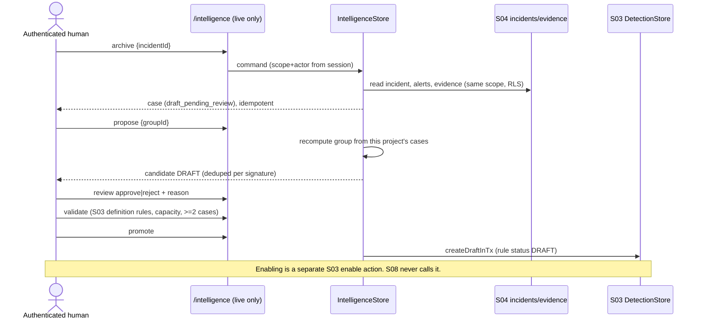

# Sentinel S08 — Internal Intelligence: Evidence-Based Case Library & Human-Reviewed Draft Rules

**Status: `DEV_ACCEPTED` on an isolated PostgreSQL 17 container + mocked-API browser fixtures (see [SENTINEL_S08_VALIDATION.md](SENTINEL_S08_VALIDATION.md)). Not applied to the persistent `wetscan_dev` database. Not deployed. No AI provider configured. External staging / production: `NOT_RUN`.**

Planning brief: `CLAUDE_PLAN_S08_Internal_Intelligence.md`. Migration: `0008_internal_intelligence` (the version was free: master head was `0007_ghost`).

## 1. What S08 does (and does not)

| Does                                                                                                                                                                 | Does not                                                                                                                   |
| -------------------------------------------------------------------------------------------------------------------------------------------------------------------- | -------------------------------------------------------------------------------------------------------------------------- |
| Archives an existing S04 incident into a **project-scoped durable case** (provenance, evidence _references_, normalized indicators, tags, annotations, actor audit). | Copy raw telemetry, actor hashes, IPs, headers, queries or free-text attributes.                                           |
| Groups cases **deterministically** (exact normalized-indicator signature, 30-day window, per origin), with an explanation and stated limits.                         | Use an LLM, fuzzy scoring or cross-project/cross-origin similarity. Similarity never means "same attacker" or "exploited". |
| Proposes a **DRAFT-only** rule candidate from a group; a human approves/rejects, then validates, then creates an S03 **DRAFT** rule.                                 | Enable anything. `ENABLED` is reachable only through the existing S03 `enable` action, by a human, separately.             |
| Pins the source incident against retention while a case is active, and reports honestly when evidence/incident later expire.                                         | Fabricate or reconstruct missing evidence; alter incident, alert or telemetry history.                                     |

## 2. Domains kept separate (never merged into one status)

| Domain                           | Values                                                                      | Owner                            | Changed by                                                                                                                       |
| -------------------------------- | --------------------------------------------------------------------------- | -------------------------------- | -------------------------------------------------------------------------------------------------------------------------------- |
| Source incident status           | `open` / `investigating` / `closed`                                         | S04 (`sentinel.incidents`)       | S04 only. S08 reads it, never writes it.                                                                                         |
| Case review status               | `draft_pending_review` → `reviewed` / `dismissed` (dismissed → reopen)      | `intel_cases.status`             | Human case action                                                                                                                |
| Case shelf state                 | `active` / `shelved`                                                        | `intel_cases.shelf_state`        | Human case action. Shelving = "set aside"; releases the retention pin; **not** resolution, rollback, deletion or neutralization. |
| Candidate review status          | `DRAFT` → `APPROVED` / `REJECTED` (terminal)                                | `intel_candidates.review_status` | Human review action                                                                                                              |
| Candidate validation / promotion | `validated_at`, `promoted_rule_id` (nullable, ordered by CHECK constraints) | `intel_candidates`               | Human validate / promote actions                                                                                                 |
| S03 rule status                  | `DRAFT` / `ENABLED` / `DISABLED`                                            | S03 (`detection_rule_versions`)  | S03 `DetectionStore.command` only. S08 displays the live value via join.                                                         |

"Archived into the library" is the creation of a case. It is deliberately not a status of the incident (`incidents.archived` stays `false`).

## 3. Minimum trustworthy schema (answer to the brief's architecture question)

Five additive tables, no LLM, no incident-history duplication:

1. `intel_cases` — one row per archived incident (`UNIQUE(incident_id)` ⇒ idempotent). Immutable provenance: incident id, source, rule id+version (FK to `detection_rule_versions`), category, severity, origin, status/revision _at archive_, first/last observed, normalized `indicators` (≤4 KB), `signature`, `grouping_version`, `archived_by/at`. Mutable only: `tags`, `status`, `shelf_state`, `revision`, `updated_at` (column grants).
2. `intel_case_evidence` — immutable `(source_id, event_id, kind, occurred_at)` references. **No FK to `telemetry_events` or `incidents`**, so telemetry/incident retention stays independent and missing evidence is detected by a live `LEFT JOIN`, never hidden.
3. `intel_candidates` — one per `(origin, signature, grouping_version)`; immutable `definition` (a validated S03 `RuleDefinition`) and `basis` (matched fields, rationale, limitations).
4. `intel_candidate_cases` — append-only membership (source-case references).
5. `intel_audit` — append-only audit for cases and candidates (`actor_id`, per-subject `sequence`, optional annotation `note`).

Groups are **not persisted**: they are recomputed per request by a pure function, so they are always reproducible from cases and can never drift or leak across scopes.

## 4. Architecture decision record

| #   | Decision                 | Options considered                                                                                                                                                                                   | Chosen & why                                                                                                                                                                                                                                                                                                                                                                                           |
| --- | ------------------------ | ---------------------------------------------------------------------------------------------------------------------------------------------------------------------------------------------------- | ------------------------------------------------------------------------------------------------------------------------------------------------------------------------------------------------------------------------------------------------------------------------------------------------------------------------------------------------------------------------------------------------------ |
| D1  | Case ↔ incident coupling | (a) FK to `incidents` + copy of evidence; (b) FK to incidents only (blocks retention); **(c) no FK, immutable reference snapshot + live join + retention _pin_**                                     | (c). (a) duplicates sensitive telemetry; (b) makes S04 retention fail. (c) keeps S04/S02 retention semantics and reports `expired`/`missing` honestly. The pin is an additive `NOT EXISTS` in `retainIncidents` (guarded by `to_regclass`, like the S05 pin): an _active, undismissed_ case holds its incident, and through `incident_evidence` the telemetry events. Shelving/dismissing releases it. |
| D2  | Grouping                 | (a) persisted cluster tables; (b) LLM/embedding similarity; **(c) lazy deterministic exact-signature grouping**                                                                                      | (c). Reproducible, explainable, no egress, no stale state. Limits: exact match only; cases lacking indicators are ungrouped. Window is measured from the newest member, not the wall clock.                                                                                                                                                                                                            |
| D3  | When to compute          | (a) durable worker task; **(b) lazy query on read/propose**                                                                                                                                          | (b). ≤1000 cases/project, O(n); no new queue or worker, so no second service (brief §1.3). Revisit if case counts or cost grow.                                                                                                                                                                                                                                                                        |
| D4  | Candidate → rule         | (a) write `detection_rules` directly with `ENABLED`; (b) separate approval service; **(c) approve → validate → promote to S03 `DRAFT` in the same transaction via `DetectionStore.createDraftInTx`** | (c). Reuses S03 capacity limits, versioning and `detection_audit`. Enabling stays the unchanged S03 action; S08 cannot reach it.                                                                                                                                                                                                                                                                       |
| D5  | Concurrency              | row-level only vs **project binding lock + row `FOR UPDATE` + expected revision**                                                                                                                    | Binding lock (`FOR UPDATE`, as in S03/S07) serializes all Intelligence commands, ingest and retention for a project; revision fencing rejects stale writers; unique constraints are the backstop.                                                                                                                                                                                                      |
| D6  | AI                       | adapter now vs **disabled port only**                                                                                                                                                                | Existing `AIExplanationPort` kept; `disabledAIExplanation` is the default and nothing calls a provider. `redactedGroupSummary` defines the maximum data any future adapter could receive (labels and counts, no ids). A real provider needs a new `HUMAN_REQUIRED` gate (see `SENTINEL_HUMAN_ACTIONS.md`).                                                                                             |

## 5. Workflow

Transitions fail closed: reject is terminal (re-proposal returns the same rejected candidate), `validate` requires `APPROVED`, `promote` requires validated and unpromoted, stale `expectedRevision` → `409 revision_conflict`. The same ordering is also enforced by `CHECK` constraints and column grants in PostgreSQL.

## 6. Grouping v1 (explainable, with limits)

- **Indicators** (allow-listed, normalized): event kinds, `attributes.reasonCode` (S03 enum only), HTTP method, status code; route templates are stored for display but not matched.
- **Signature** = SHA-256 of `{v, origin, category, eventKinds, reasonCodes, methods, statusCodes}`. `controlled_test` and `runtime` never mix; the signature is project-independent but groups are only ever built from one project's rows.
- **No indicators ⇒ no signature ⇒ never grouped** (counted as ungrouped).
- **Group** needs ≥2 active, undismissed cases whose `last_observed_at` is within 30 days of the newest member. Output lists matched fields, window, excluded older cases, confidence (`exact_indicator_match`) and limitations.
- **Proposal**: conditions only for single-valued indicators (multi-valued ones are reported as `conditionsNotExpressed`, never widened); `threshold` = smallest member evidence count and `windowSeconds` = largest member span, so the rule _would have matched every member_; confidence fixed at 50; `correlation: "source"`; refuses (`422 no_expressible_condition`) when nothing is expressible. No back-test is claimed.

## 7. Security model

- **Authorization**: same `authorizeSentinelProject` as every Sentinel route (session → Canvas/GitHub repository access → server-derived `{mode:'live', workspaceId, projectId}`); `orderly-demo` and non-`github-<id>` ids return 404 before auth/storage; POST requires same-origin; the body is parsed by a strict allow-list that rejects `workspaceId`, `projectId`, `mode`, `actorId`, `definition` etc.
- **RLS**: all five tables `ENABLE`+`FORCE ROW LEVEL SECURITY`, `mode='live'`, scoped by `wetscan.{module,mode,workspace,project}`; `WITH CHECK` limits writes to `wetscan_app`; the worker only has `SELECT` on `intel_cases` (for the retention pin).
- **Immutability**: no role has `UPDATE`/`DELETE` on audit, evidence refs or candidate membership; no role can update case provenance or candidate `definition`/`basis`; no `DELETE` grant on any S08 table.
- **No demo coupling**: Orderly Demo keeps its original synthetic Intelligence screen (`src/domain/demo.ts` and the preserved dispatcher untouched). The live screen is a separate component mounted only for `github-<id>` projects; DEMO state never writes to the live API.
- **Egress/secrets**: no network call is made by S08. Indicators contain no actor hash/IP/header/query/free text (tested with canaries). Errors map to fixed codes; internals are not echoed.
- **Retention policy**: cases and audit are kept indefinitely in S08 (no automatic deletion; bounded by 1000 cases and 200 candidates per project). Source incidents follow S04 retention except while pinned. Deleting a project binding is blocked by `ON DELETE RESTRICT`. A formal case-expiry policy is deferred (see Limitations).

## 8. Files

| Area                   | Files                                                                                                                                                                                              |
| ---------------------- | -------------------------------------------------------------------------------------------------------------------------------------------------------------------------------------------------- |
| Migration              | `migrations/sentinel/0008_internal_intelligence.{up,down}.sql`; down-guard in `src/platform/migrations.ts`                                                                                         |
| Domain                 | `src/features/sentinel/intelligence/{model,grouping,validation,store,case-library}.ts`                                                                                                             |
| API                    | `src/features/sentinel/server/intelligence-http.ts`, `src/app/api/sentinel/projects/[projectId]/intelligence/route.ts`                                                                             |
| UI                     | `src/features/sentinel/components/live-intelligence.tsx`; seams: `components/views/sentinel.tsx` (+3 lines), `.../sentinel/[[...section]]/page.tsx` (+1), `components/app-shell.tsx` (nav + regex) |
| Seams in other modules | `DetectionStore.createDraftInTx` (additive), `retainIncidents` pin (additive), `CaseLibraryPort` result status widened to the case status union                                                    |
| Tests                  | `tests/sentinel/intelligence*.test.ts`, `intelligence.postgres.integration.ts`, `intelligence.spec.ts`                                                                                             |

## 9. Limitations / deferred

- Persistent `wetscan_dev` upgrade to `0008` and sealed approvals: `NOT_RUN` (owner-gated, see handoff).
- No historical backfill; no automatic archival from incident close (humans archive).
- No case-expiry job; no cross-project/organization intelligence (by design).
- No back-testing of candidates against telemetry; candidate confidence is fixed.
- No AI explanation adapter (port only). No external advisory feed (S09).
- Intelligence UI is verified with mocked-API browser fixtures plus PostgreSQL store tests; an authenticated end-to-end browser run against a real GitHub session was not performed.
