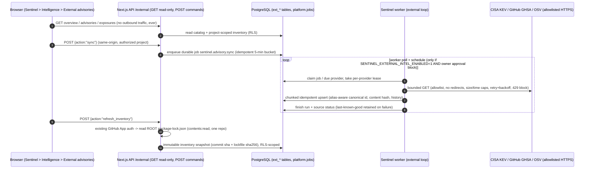

# Sentinel S09 — External Intelligence (CISA KEV / GHSA / OSV feeds & evidence-based potential exposure)

Date: 19 Nov 2026 · Branch: `feat/sentinel-s09-external-intelligence` (from `master@e59b03c`, head `0008_internal_intelligence`) · Migration: `0009_external_intelligence`.

Status vocabulary used here and in the validation report: `implemented` · `fixture-tested` · `DEV_ACCEPTED` (executed on an isolated disposable PostgreSQL 17 + mocked-API browser fixtures + bounded real-feed smoke test) · `LIVE_TESTED` · `NOT_RUN` · `DEFERRED` · `NOT_CONFIGURED`. S09 is **`DEV_ACCEPTED`** for feeds, catalog, inventory and exposure logic; it is **not** `LIVE_TESTED` against a persistent environment (see [HANDOFF_S09](agent-handoffs/HANDOFF_S09.md)).

## 1. The architecture question: useful advisories before GRD-020, without misleading anyone

Public advisory intelligence and project exposure are **two independent layers with different evidence**:

| Layer                                                                       | Evidence it rests on                                                                | What S09 will say                                                                                                                                                                       | What S09 will never say                                                                              |
| --------------------------------------------------------------------------- | ----------------------------------------------------------------------------------- | --------------------------------------------------------------------------------------------------------------------------------------------------------------------------------------- | ---------------------------------------------------------------------------------------------------- |
| **Advisory catalog** (global, no project data)                              | Authentic provider records with source id, URL, retrieval time, raw-record sha256   | "CVE-… exists, GitHub/OSV say package `x` < `1.2.3` is affected, CISA lists it as known-exploited since …, last synced … (fresh/stale)"                                                    | That this project is affected, deployed, exploited or attacked                                      |
| **Potential repository exposure** (project-private, computed at read time) | A _verified, provenance-linked_ dependency inventory snapshot + the catalog         | "Declared dependency `lodash@4.17.20` in `package-lock.json` @ commit `abc…` matches GHSA-… (`< 4.17.21`), fixed in `4.17.21`" — labelled **potential**, with exact evidence             | Deployment, exploitability, compromise; "safe" or "clean" for anything                              |
| **No / untrusted inventory**                                                | Nothing                                                                             | **`Cannot assess project exposure`** with the reason (`no_inventory`, `inventory_expired`, `inventory_empty`, `no_assessable_ecosystem`, `advisory_data_unavailable`)                  | A clean result, an empty "0 vulnerabilities" card, or a fabricated finding                           |

Concretely, before Guard GRD-020 exists a user already gets a real, attributable, freshness-labelled advisory explorer and per-source feed health (value with no inventory at all). Exposure is only ever produced from an **already authorized repository lockfile** that the user explicitly collects, and is always worded as _declared dependencies_. GRD-020 stays `not_integrated`: nothing writes a Guard-sourced snapshot (the table's `source_kind` CHECK only admits `repository_lockfile`), and `guardInventoryPort.configured === false`.

## 2. Verified repository baseline and discrepancy report

- `master@e59b03c` (S08 merged, PR #12), clean tree, migration head `0008_internal_intelligence` — matches the brief's "latest verified baseline". The brief's `master@db3ec705` snapshot was historical and **not** assumed.
- Discrepancy: the S09 brief says `S09 NOT_STARTED`; reverified — no catalog tables, sync worker, or exposure engine existed. `AdvisoryFeedPort` (`contracts.ts`) existed as an interface only; its shape (`sync(cursor)` → `{id, aliases, sourceUrl, summary}[]`) cannot carry ranges, timestamps or provenance, so S09 does **not** implement it verbatim (kept untouched as history; the persisted pipeline below is the real surface). `GuardInventoryItem`/`InventoryItem` (`name, version, ecosystem, license, sourcePath`) stays the compatibility target for a future GRD-020 producer: `model.ts#InventoryItem` uses the same `name/version/ecosystem` fields.
- Discrepancy: the existing `GitHubRepositorySnapshotReader` skips lockfiles in practice (priority list excludes `package-lock.json`; 256 KB/file, 200-file cap). S09 therefore adds a narrow separate reader (§6) instead of changing Canvas code.
- Discrepancy: `AdvisoryFeedPort.provider` lists `nvd`; NVD is **not implemented** (optional in the brief; `NVD_API_KEY` is not configured). Status: `DEFERRED` / `NOT_CONFIGURED`.
- Real-feed findings that shaped the code (observed 19 Nov 2026): GitHub's `updated` filter rejects a full ISO timestamp with **422** and accepts date granularity (`>=YYYY-MM-DD`); the CISA origin answered **200** to a conditional request (no 304 observed) — repeat syncs are therefore idempotent by content hash rather than relying on ETag.

## 3. Data flow

## 4. Files (new unless marked)

| Area                          | Files                                                                                                                                                                                                                                     |
| ----------------------------- | ----------------------------------------------------------------------------------------------------------------------------------------------------------------------------------------------------------------------------------------- |
| Migration                     | `migrations/sentinel/0009_external_intelligence.{up,down}.sql`; `src/platform/migrations.ts` (**modified**: reversal guard for 0009)                                                                                                       |
| Domain (`src/features/sentinel/external/`) | `model.ts` (types/limits/status), `versions.ts` (per-ecosystem comparators and range logic), `normalize.ts` (provider → canonical assertions, identifiers), `feeds.ts` (allowlist + bounded HTTP client), `sync.ts` (per-provider sync), `catalog-store.ts` (global catalog, leases, ledger), `inventory-store.ts` (project snapshots, ports), `exposure.ts` (read-time assessment), `lockfile.ts`, `activation.ts` (network gate), `service.ts`, `status.ts`, `validation.ts` |
| Worker                        | `worker/sentinel/external-sync.ts` (the only outbound lane); `runtime.ts` + `main.ts` (**modified**: start the lane only when activated)                                                                                                   |
| API                           | `src/features/sentinel/server/external-http.ts`, `lockfile-reader.ts`; `src/app/api/sentinel/projects/[projectId]/external/route.ts`                                                                                                       |
| UI                            | `components/live-external.tsx`; `components/live-intelligence.tsx` (**modified**: "Case library (internal)" / "External advisories" switch; internal body unchanged); `globals.css` (`.link-button`)                                         |
| Tests                         | `tests/sentinel/external-{versions,normalize,feeds,sync,lockfile,activation,migrations,http}.test.ts`, `external.postgres.integration.ts` (+`external-pg-harness.ts`, `external-postgres.config.ts`), `external-live-smoke.live.integration.ts` (+`external-live.config.ts`), `external.spec.ts` (+`external.playwright.config.ts`) |
| Pinned older tests (modified) | `tests/platform/migrations.test.ts`, `tests/sentinel/{ghost,intelligence}-migrations.test.ts`, `tests/sentinel/{ghost,intelligence}.postgres.integration.ts` — "latest migration" assumptions now account for `0009` (same pattern S08 used)  |

No change to `src/features/guard/**`, `worker/guard/**`, `src/features/canvas/**`, `src/domain/demo.ts`, `src/components/demo-provider.tsx`, S01–S08 migrations, `provision-roles*.sql`.

## 5. Schema (`0009_external_intelligence`, 7 tables, additive, forced RLS on all)

Global catalog (no tenant columns; **app role read-only, only the worker role writes**, enforced by grants _and_ forced-RLS role policies):

- `ext_sources(provider PK)` — status (`never_run|ok|partial|degraded|failed|rate_limited`), `last_attempt_at`, `last_success_at`, `last_error_code` (fixed codes), `consecutive_failures`, `etag`, `watermark`, `feed_version`, `blocked_until` (429 window), `record_count`, per-provider **lease** (`lease_owner/lease_until`). Three seed rows only.
- `ext_runs` — append/prune ledger of every attempt (trigger, status, http status, requests, bytes, seen/changed/rejected, error code). Pruned to ≤200 per provider and 90 days.
- `ext_advisories(provider, source_id)` — one row **per provider assertion** (never overwritten by another provider): `canonical_id`, `ident[]` (GIN), `status` (`active|withdrawn|removed_from_source`), title/summary, source-provided `severity`/CVSS vector/score, `kev` jsonb (only `cisa_kev`), published/modified/withdrawn, `source_url` (https only), `feed_version`, `retrieved_at`, **`raw_sha256`** (hash of the provider's raw record), `content_hash`, `revision`, `osv_checked_at`.
- `ext_affected` — normalized `ecosystem`, `package_name`, `ranges` (introduced/fixed/lastAffected), explicit `versions`, `fixed`, `certainty` (`verified|uncertain`).
- `ext_history` — append-only normalized snapshot per changed revision (pruned to the last 10, ≤64 KB each).

Project-private (`mode='live'` CHECK, FK `RESTRICT` to `project_bindings`, forced RLS bound to `wetscan_app` + the four `wetscan.*` session settings; **the worker role has no grant at all**):

- `ext_inventory_snapshots` — `source_kind='repository_lockfile'` (CHECK; no guard-sourced snapshot can exist), repository id, `commit_sha`, `lockfile_path`, `lockfile_sha256`, `lockfile_version`, `item_count`, `collected_by`, `collected_at`, `expires_at` (7 days). Provenance columns are immutable (app may only `UPDATE(collected_at, expires_at, collected_by)` to re-verify the same commit+lockfile). `UNIQUE(scope, commit_sha, lockfile_sha256)`.
- `ext_inventory_items` — `ecosystem`, `package_name`, `version`, `dep_scope`; append-only (plus delete for retention).

**Exposure is not persisted.** It is derived at read time from snapshot + catalog (`exposure.ts`), so a catalog update, withdrawal or retraction is reflected immediately and there is nothing stale to recompute or migrate.

## 6. Providers, adapters and limits

| Provider                               | Endpoint (exact allowlist)                                                                                                                | Strategy                                                                                                                                                                                  | Caps                                                                                  |
| -------------------------------------- | ----------------------------------------------------------------------------------------------------------------------------------------- | ----------------------------------------------------------------------------------------------------------------------------------------------------------------------------------------- | ------------------------------------------------------------------------------------- |
| CISA KEV                               | `https://www.cisa.gov/sites/default/files/feeds/known_exploited_vulnerabilities.json`                                                    | Full snapshot; conditional request with stored ETag when offered; plausibility guard (a snapshot shrinking below 50% is rejected, nothing is marked removed); absent records → `removed_from_source` | 8 MB body                                                                             |
| GitHub Global Security Advisories      | `https://api.github.com/advisories?type=reviewed&per_page=100&sort=updated&direction=asc&updated=>=<day>` (+ same-endpoint `after` cursor) | Incremental by day watermark; persisted page cursor so a busy day cannot stall; `Link rel=next` followed only if it stays on the allowlisted endpoint; optional token from a **file** (`SENTINEL_FEED_GHSA_TOKEN_FILE`), sent to `api.github.com` only | 6 MB/page, 3 pages/run                                                                |
| OSV                                    | `https://api.osv.dev/v1/vulns/<id>` (`id` regex-bound)                                                                                    | **Enrichment by id**: GHSA ids already in the catalog without an OSV record (oldest-checked first), then the oldest-retrieved OSV rows for withdrawal/updates. No project data is ever sent to OSV | 1 MB/record, 25 ids/run                                                               |
| NVD                                    | —                                                                                                                                         | `DEFERRED` / `NOT_CONFIGURED`. Not required by any core feed; no `NVD_API_KEY` is read.                                                                                                   | —                                                                                     |

Every request: `https:` only, exact host+path, no credentials/port/fragment, `redirect:"manual"` (any 3xx → `unsafe_redirect`, never followed), `credentials:"omit"`, declared + streamed size cap, 10 s timeout, JSON `fatal` UTF-8 decode, ≤30 requests/run, ≤2 retries (500 ms·2ⁿ + jitter, 5xx/timeout/network only), **429/exhausted rate limit → no retry**, `Retry-After`/`x-ratelimit-reset` stored as `blocked_until` (≤24 h; default 15 min) and honoured by both manual and scheduled runs. Errors are fixed codes; provider bodies, URLs and tokens never enter errors, logs, ledger or API.

## 7. Normalization, identity and conflicts

- Identifiers are canonicalized (`CVE-` upper, `GHSA-` lower tail) and validated; reserved prefixes must be well formed.
- `canonical_id` = minimum identifier over the whole alias cluster by (CVE < GHSA < other, then lexicographic) — independent of arrival order. Clusters are connected components over shared identifiers; an incoming record loads its **entire existing cluster** first so a merge never splits a joined group and earlier rows are moved to the new canonical id in the same transaction.
- A provider's assertion is never rewritten by another provider. Two providers asserting different ranges for the same package set `conflicting` — shown unmerged in the UI and in exposure evidence (`Sources disagree`); an exposure is reported when at least one active source asserts the installed version is affected, with each source's verdict listed.
- Updates change `content_hash` → new `revision` + `ext_history` row; unchanged records only refresh `last_seen_at`/`retrieved_at`. Withdrawn advisories (`withdrawn_at`/`withdrawn`) and KEV removals are retained with a status and excluded from exposure matching.

## 8. Version matching methodology (per ecosystem, never generic strings)

- **npm, crates.io, Go**: SemVer 2.0 (numeric core, pre-release identifier rules, build metadata ignored; Go's `v` prefix accepted). Range bounds may omit minor/patch (`>= 4.0` = `4.0.0`); **installed versions must be complete**.
- **PyPI**: PEP 440 (epoch, release zero-padding, pre/post/dev, local versions).
- **maven, nuget, rubygems, packagist, pub, hex, swift, actions, other**: no comparator ⇒ `matched = null` ⇒ the item is counted as _not assessed_ (never "not affected").
- OSV events are sorted with the ecosystem comparator (`introduced "0"` first), then paired introduced→fixed/last_affected; `GIT` commit ranges and unparsable/uncomparable events mark the entry `uncertain`. GHSA `vulnerable_version_range` supports `>=`, `<`, `<=`, `=` (inclusive lower bound only); exclusive lower bounds, duplicated bounds and junk are `uncertain`.
- `versionMatches` returns `true | false | null`; `false` only when every involved comparison was decided by a certain entry. Anything undecided is reported as `uncertainAdvisories` in the coverage and never as "no exposure".

## 9. Inventory (declared dependencies only)

- Source: ROOT `package-lock.json` (lockfile v2/v3) of an **already authorized** repository, fetched through the existing GitHub App installation (`contents:read`, single repository id, token revoked after use), integrity-checked (git blob SHA-1 + size), max 5 MB / 10 000 distinct packages. v1 trees, git/file/link entries, workspace members and non-SemVer versions are skipped and **counted**; oversize/malformed/unsupported files store nothing. No second OAuth/registry, no code executed, no cache.
- Reuses `authorizeCanvasProject` (session → profile → current-user repository access + App installation checks). `src/features/canvas/**` is untouched.
- Snapshot validity 7 days (`expires_at`); retention 5 snapshots per project. Only `repository_lockfile` exists; GRD-020 is a documented future producer and `guardInventoryPort` reports `configured:false`.
- Declared dependencies ≠ deployed dependencies; the UI and API repeat this wherever a result is shown.

## 10. Worker and scheduling

- One extra lane, `externalLoop`, beside (not inside) the telemetry/detection loop so a slow provider cannot delay incident processing. It is created **only** when `SENTINEL_EXTERNAL_INTEL_ENABLED=1` **and** the owner approval JSON carries an `externalIntel` block (`mode:"live"`, bound `workspaceId`/`projectId`, `notBefore` ≥ approval time, provider list, `approvedUse:"public_advisory_feeds"`); anything else → `approval_required`, flag alone enables nothing, and the lane is not even constructed when migration `0009` is absent.
- Manual: durable job `sentinel.advisory.sync` (existing S01 queue, `maxAttempts 3`, subject = provider, idempotency key `advisory-sync:<provider>:<5-min bucket>`, deterministic `availableAt`) claimed by the activated project scope. Providers outside the approved list are never executed (job retries/fails).
- Scheduled: every poll the lane asks the catalog which providers are due (default every 6 h; failed/degraded retry after ≤30 min; partial backfill after 1 min; never while `blocked_until` or leased).
- **Idempotency & crash recovery**: the per-provider DB lease (budget + 30 s) lets exactly one run fetch; a crashed holder's lease expires on its own. Upserts are content-hash idempotent; a run that fails or exceeds its time budget never advances `last_success_at` (it can advance the GHSA watermark/page cursor), so freshness never lies. Shutdown aborts the in-flight request and releases the lease.
- Resource limits: ≤2 concurrent jobs (existing `module_limits`), job timeout `SENTINEL_JOB_TIMEOUT_MS` (default 20 s ⇒ ≈17 s sync budget for manual jobs), scheduled budget `SENTINEL_FEED_SYNC_BUDGET_MS` (default 40 s, max 55 s), ≤100 records per transaction, catalog hard cap 300 000 advisories (`storage_limit`), `--max-old-space-size=256` worker flag unchanged.
- The Next.js API module imports neither `feeds.ts` nor `sync.ts` (asserted by a static test); GET handlers cannot reach the network.

## 11. API & UI

`/api/sentinel/projects/[projectId]/external` — same auth/scope pattern as S08 (`authorizeSentinelProject`, live-only, same-origin on POST, strict allow-listed wire, no scope/actor/URL/credential from the client).

- `GET` overview (sources, runs, totals, queued requests, inventory) · `?view=advisories` (search `q`, `provider`, `severity`, `kev=1`, `ecosystem`+`package`, `status`, `offset`≤2000, 25/page) · `?advisoryId=` detail with unmerged assertions + history · `?view=exposures`.
- `POST {action:"sync", providers?}` → **202**, jobs only · `POST {action:"refresh_inventory"}` → reads the lockfile, stores a snapshot.
- UI: Sentinel → Intelligence gains an **External advisories** switch next to the preserved **Case library (internal)**: feed status table (status/freshness/last success/last attempt/records/back-off), recent runs, inventory provenance, exposure verdict (`Potential repository exposure` / `No match within coverage` / `Cannot assess project exposure`), Advisory Explorer, advisory detail with provenance, aliases, ranges, KEV facts and revision history. Orderly Demo (`src/components/views/sentinel.tsx#Intelligence`) is unchanged and cannot reach the live API.

## 12. Security & isolation

AuthN/Z reused (no new OAuth/registry); `workspaceId/projectId/mode` always server-derived. Global catalog readable by any authorized live project member but contains **no** project data (schema test); project data protected by forced RLS and zero worker grants; app cannot write catalog; worker cannot read inventory; snapshot provenance immutable; SSRF/redirect/size/time bounds as above; secrets only via file/approval, redacted everywhere; advisory data never touches telemetry/alerts/incidents/response/notification/case tables (static + runtime assertions); `DEMO` (`orderly-demo`) is rejected before auth; `CONTROLLED_TEST` evidence is unaffected because S09 neither reads nor writes event origins.

## 13. Architecture decision record

| Decision                               | Options considered                                                                                                                                                    | Chosen & why                                                                                                                                                                                         |
| -------------------------------------- | --------------------------------------------------------------------------------------------------------------------------------------------------------------------- | ---------------------------------------------------------------------------------------------------------------------------------------------------------------------------------------------------- |
| Where exposure lives                   | (A) persisted exposure rows recomputed after each sync; (B) **computed at read time**                                                                                  | **B** — no staleness class, no recompute job/migration, retraction is instant; cost is one indexed join bounded by 10 000 items. A persisted audit trail can be added later if a workflow needs it.        |
| Catalog tenancy                        | (A) per-project copies of advisories; (B) **one global catalog + project-private inventory**                                                                           | **B** — public data stored once, no inventory leakage via the catalog, simple retention. Risk: any project member can read the global catalog (public data by definition).                              |
| How scheduled sync runs                | (A) enqueue per-project jobs for every tick; (B) **global per-provider DB lease; manual = durable project job, scheduled = direct lane**                               | **B** — global data must be fetched once, not once per project; the lease makes duplicates/crashes safe; reuses the S01 queue for the manual (authorized) path.                                        |
| OSV usage                              | (A) `querybatch` with project package versions; (B) **enrichment by already-known GHSA ids**                                                                           | **B** — never discloses private dependency inventory to a third party and keeps OSV independent of GRD-020. (A) is a possible future opt-in behind a data-use decision (`H-S09-OSV-QUERY`).                |
| Inventory source                       | (A) extend the Canvas snapshot reader; (B) **narrow separate root-lockfile reader on the same App installation**                                                       | **B** — Canvas code is owned elsewhere and deliberately caps files; the new reader is ≈100 lines, read-only, single-file.                                                                              |
| Canonical identity                     | (A) trust one provider's id; (B) **alias-cluster minimum identifier, assertions kept per provider**                                                                    | **B** — deterministic, order-independent, preserves disagreement instead of merging claims.                                                                                                            |

## 14. Non-goals, deferred and residual risks

- `DEFERRED`: NVD adapter; Guard GRD-020 producer integration (`not_integrated`); lockfile formats other than root npm v2/v3 (pnpm/yarn/pip/Maven), monorepo sub-lockfiles; OSV `querybatch`; ecosystems without comparators (Maven/NuGet/RubyGems/Packagist…); exposure notifications/incidents (S10+); persistent `wetscan_dev` upgrade.
- Risk: alias merging trusts provider-asserted aliases (a malicious/incorrect alias would join clusters; assertions stay separate so ranges are never merged). Risk: GHSA unauthenticated rate limit (60/h) bounds backfill speed (~3 requests/run); a token file raises it. Risk: CISA KEV/OSV availability and format drift — surfaced as `degraded/failed` with last-known-good retained. Risk: day-granularity GHSA re-reads are bounded by content-hash skipping and the persisted page cursor.
- Environment variable names (no values): `SENTINEL_EXTERNAL_INTEL_ENABLED`, `SENTINEL_FEED_INTERVAL_MS`, `SENTINEL_FEED_SYNC_BUDGET_MS`, `SENTINEL_FEED_GHSA_TOKEN_FILE` (optional), plus the existing `SENTINEL_DB_*` and `SENTINEL_JOB_*` / `SENTINEL_WORKER_*` variables. `NVD_API_KEY` is intentionally unused.
