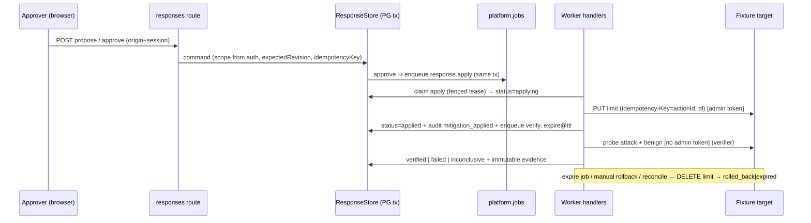

# Sentinel S05 — Controlled Response, Independent Verification & TTL Rollback — Implementation Plan

> **Status: APPROVED and EXECUTED by the owner on 2026-11-19** (owner decisions: TTL 600 s, self-approval allowed on the controlled fixture, in-repo loopback fixture, isolated database, local retention pin). See `docs/SENTINEL_S05_ARCHITECTURE.md` for what was built; deviations are listed in CHANGELOG_FIXES Fix #5.
> Original gate text follows for history.
>
> ~~PLAN ONLY — NOT AUTHORIZED TO IMPLEMENT.~~
> Approval of this plan does **not** authorize migrations, DB access, provider/target traffic, worker activation, publication or deployment.
> For agentic workers (after separate go-ahead): REQUIRED SUB-SKILL `superpowers:subagent-driven-development` or `superpowers:executing-plans`. Steps use `- [ ]`.

**Goal:** Narrowly authorized, reversible, independently verified responses to S04 incidents on one owner-controlled local fixture, with durable TTL rollback.
**Architecture:** New additive `sentinel.response_*` tables (migration `0005_response`) + pure policy/state machine + `ResponseStore` (same `db.scoped` + `FOR UPDATE` + revision pattern as `IncidentStore.command`) + new worker job kinds on the existing `PostgresQueue` + a loopback-only fixture adapter and a credential-less verifier. S04 tables/timeline/`verification_status` are never touched.
**Tech stack:** Next.js route handlers, `pg` via `src/platform/database.ts`, Vitest, Playwright, Node `http` (fixture). No new dependencies.
**Spec:** `CLAUDE_PLAN_S05_Controlled_Response.md` (repo root brief) + `docs/SENTINEL_HUMAN_ACTIONS.md:87-93` (H03).

## Global Constraints
- Every table/query scoped by `mode='live'`, `workspace_id`, `project_id`; scope comes only from `authorizeSentinelProject` (`server/project-context.ts`), never from body/query.
- `FORCE ROW LEVEL SECURITY`, policy `current_user IN ('wetscan_app','wetscan_sentinel_worker')` + `wetscan.module='sentinel'` — copy 0004 policy block verbatim.
- Operation enum is only `temporary_rate_limit` (`types.ts:110`). Target kind only `local_fixture`. TTL ≤ min(target max, `SENTINEL_RESPONSE_MAX_TTL_SECONDS`); 600 s is a *proposal*, not approved.
- Env names only: `SENTINEL_RESPONSE_ENABLED`, `SENTINEL_RESPONSE_BASE_URL`, `SENTINEL_RESPONSE_TOKEN`, `SENTINEL_RESPONSE_MAX_TTL_SECONDS`, `SENTINEL_FIXTURE_PORT`. Default = unset ⇒ `NO-OP / NOT_CONFIGURED`.
- `applied` ≠ `verified`. Provider/adapter acceptance never writes a verified state. Everything unexecuted stays `NOT_RUN`.

## Review Focus (failure modes the brief implies but no single test owns)
1. Closed incident or `investigating→closed` race while action is `applying` → rollback still runs; closing never implies mitigation (T3, T6).
2. Worker killed between target PUT and DB commit (orphan enforcement) → target-side TTL + reconcile adopts/cleans (T4, T6).
3. Incident retention deletes closed incident while response audit exists (FK RESTRICT would block / append-only forbids delete) → pin (T9).
4. Self-approval deadlock on a single-owner project (no role model exists: `actorId = github-user-<id>`) → owner decision Q2.
5. Verifier passes because attack probe was *already* blocked before apply (no baseline) → baseline pre-check ⇒ `inconclusive` (T5).

---

## 1. Repository snapshot & discrepancy report (read-only evidence)

| Item | Observed |
|---|---|
| Branch / HEAD | `feat/sentinel-s04-incidents` @ `a48f11d`, worktree clean, tracks origin |
| master | `db3ec70` = merge of PR #8; `a48f11d` **is an ancestor of master** → this checkout is the *merged feature branch*, not master. S05 must branch from `master`. |
| Migration head | `0004_incidents` (`migrations/sentinel/0001..0004`). `0005_response` is free. |
| Docs dir | No `docs/superpowers/` before this file. |

Discrepancies (most recent supported evidence wins; nothing edited):
1. **S04 status:** `docs/agent-handoffs/HANDOFF_S04.md:3-8` still says `IMPLEMENTED_PENDING_ACCEPTANCE`; commit `620f11d` "S04 accepted" + PR #8 merge are later. Treat S04 as *accepted per commits*; test counts **not re-run** (`NOT_RUN`).
2. **"H03" is overloaded:** S03 handoffs use H03A/H03B/H03C (DB acceptance steps); S05 gate is H03 *controlled response scope* (`HUMAN_ACTIONS.md:87`). Plan uses **`H03-RESPONSE`** in new docs to avoid confusion.
3. **S04 schema blocks the "obvious" design:** `0004:8` `verification_status CHECK(=... 'not_requested')`; `0004:39` `incident_timeline.event_type CHECK IN (3 values)`; `0004:68` app role has no UPDATE on `verification_status`. Therefore S05 *cannot* record response events in the incident timeline or advance `verificationStatus` without rewriting accepted S04 → rejected (ADR-1).
4. **Contract gaps:** `ResponsePort` (`contracts.ts:95`) has `apply`/`rollback` only — no state read (needed for reconcile); `rollback` result has no `actionId`. Add an *optional* `inspect()` (additive, no breakage).
5. **Queue guard:** `queue.ts:83,308` hard-codes `sentinel.telemetry.accepted` **only when `admission` (acceptance isolation) is set**. Non-isolated `PostgresQueue(db, scope, kinds[])` accepts any kind; `platform.jobs.kind` is unconstrained (`0001:32`). Isolation-mode S05 acceptance needs a small owner-reviewed seam (T6b).
6. **Demo adapter** `services/adapters.ts:17-70` already has `ResponseAdapter {mode:"demo"|"live"}` returning synthetic 429/200 — keep untouched; live path is a separate module.
7. HUMAN_ACTIONS says "Codex first supplies unavailable/NO-OP behavior" — plan makes NO-OP the default and first deliverable.

## 2. Existing implementation map (reuse / modify / create)

| Concern | Reuse | Modify (minimal seam) | Create |
|---|---|---|---|
| AuthZ/scope | `authorizeSentinelProject`, `canvasIdentity`, `workspaceScope`, `requireOrigin` (`incident-http.ts`) | — | `server/response-http.ts`, `app/api/sentinel/projects/[projectId]/responses/route.ts` |
| Store pattern | `IncidentStore.command` (`store.ts:861`): scoped tx → lock binding → `FOR UPDATE` row → `expectedRevision` → idempotency_key | — | `response/store.ts` |
| Validation | `incidentCommand` style (`validation.ts:51`), `TelemetryError` | — | `response/validation.ts` |
| Queue | `PostgresQueue.enqueue/claim` with `availableAt` (TTL timer = durable job) | `runtime.ts` ~L225: add 2nd queue for response kinds | `worker/sentinel/response-handlers.ts` |
| Activation | `incidentActivation` (`activation.ts`) pattern | `main.ts:37-47` add `SENTINEL_RESPONSE_ENABLED` | `response/activation.ts` |
| Retention | `retainIncidents` (`retention.ts`) | add `NOT EXISTS response_actions` pin | — |
| Types | `ResponseProposal`, `VerificationResult`, `LifecycleEvent` (`types.ts:70-127`) | none (audit has own event enum) | `response/model.ts` |
| UI | `LiveIncidents` mounted at `views/sentinel.tsx:104`; demo Responses tab (`:279`) | one mount line | `components/live-responses.tsx` |

## 3. Scope contract

**In:** proposal + transparent policy; per-action durable approval; state machine; one `local_fixture` rate-limit adapter; independent verifier (attack blocked **and** benign allowed); durable TTL/rollback/reconcile; append-only audit; project-scoped API + live UI; Orderly Demo unchanged.
**Out:** production IP block, CDN/WAF/firewall/cloud, autonomous/AI enforcement, severity-based auto-approval, changes to S04 lifecycle, S06/S07 features, any non-loopback target.

**States** (`response_actions.status`): `proposed → awaiting_approval → approved → applying → applied → verification_pending → verified | failed | inconclusive`; terminal/exit: `denied`, `rolled_back`, `expired`, `apply_failed`. `verified` is only reachable from `verification_pending` via a verifier audit row. UI label for `verified` = "Neutralization verified (fixture scope)" — never for `applied`.

**Permissions** (no role model exists, so approver list is data in `response_targets.approver_actor_ids`, set from H03):
| Action | Who | Rule |
|---|---|---|
| propose | any authorized project actor | policy must pass; creates `awaiting_approval` |
| approve / deny | actor ∈ target approvers | **proposer ≠ approver** (default); approval has `expires_at` ≤ 15 min and binds `{incident, target, op, ttl, revision, idempotencyKey}` |
| apply | worker only | never HTTP; requires unexpired approval re-checked at apply time |
| rollback | approver ∈ list or system (TTL/reconcile) | idempotent |

Severity (any level) never authorizes; only a target-specific approval does. Modes: DEMO never touches DB/target; `controlled_test` incidents (`origin`) are labelled in every response record (`incident_origin` copied) and UI badge.

## 4. Architecture decision records

**ADR-1 Where responses are recorded.** A) incident timeline + `verification_status` (needs relaxing accepted 0004 CHECKs/grants). B) **separate `response_*` tables + audit (recommended)**: append-only, no S04 regression, `verificationStatus` stays `not_requested`; incident detail API gets an *additive* `responses` field via separate query. Cost: UI joins two sources.
**ADR-2 Adapter/verifier placement.** A) **in worker process, distinct modules/jobs, verifier holds no admin token and uses probe-only endpoints (recommended, smallest diff)**. B) verifier as separate OS process/credentials (true trust separation, +script, +IPC/job plumbing). v1 = A; B is documented upgrade. Residual: A shares host/DB role, so "independent" = independent code path + credential + evidence, not independent trust domain.
**ADR-3 TTL mechanism.** A) browser/Next timer — rejected. B) **durable `response.expire` job at `availableAt=expires_at` + fixture-side self-expiry (defense in depth) + periodic `response.reconcile` (recommended)**. C) DB cron — new infra, rejected.
**ADR-4 Fixture.** A) real nginx/Envoy — new dependency/runtime. B) **tiny in-repo Node `http` fixture on `127.0.0.1` (recommended)**: `PUT/DELETE/GET /admin/limit` (bearer `SENTINEL_RESPONSE_TOKEN`), `GET /probe/attack` (429 only while limit active and header `x-wetscan-probe: <nonce>` present), `GET /probe/benign` (always 200). Owner may later point the same adapter at their real local app if it exposes the same 3 endpoints.

**Answer to the architecture question:** minimal safe set = `local-rate-limit-adapter.ts` (loopback `fetch`, `redirect:"error"`, 3 s timeout, 4 KB cap, exact `origin` equality with `response_targets.origin`) + `verifier.ts` (probe-only, no token) + `scripts/sentinel-response-fixture.ts`. No production access, no new deps.

Impact: S01 platform untouched except optional queue-guard seam; S02/S03 untouched; S04 gets read-only reuse + retention pin; S06 (notifications) may later consume `response_audit` via outbox — out of scope.

## 5. Proposed change manifest (NOT created)

| File | Kind | Owner/review |
|---|---|---|
| `migrations/sentinel/0005_response.up.sql` / `.down.sql` | new | owner (migration review doc) |
| `src/features/sentinel/response/{model,policy,validation,store,activation,local-rate-limit-adapter,verifier}.ts` | new | Sentinel |
| `worker/sentinel/response-handlers.ts` | new | Sentinel worker |
| `scripts/sentinel-response-fixture.ts`, `scripts/sentinel-response-acceptance.ts` | new | Sentinel |
| `src/features/sentinel/server/response-http.ts`, `src/app/api/sentinel/projects/[projectId]/responses/route.ts` | new | Sentinel |
| `src/features/sentinel/components/live-responses.tsx` | new | Sentinel UI |
| `src/features/sentinel/contracts.ts` | edit: optional `ResponsePort.inspect?` | shared contract — owner review |
| `worker/sentinel/{main,runtime}.ts` | edit: flag + second queue | Sentinel worker |
| `src/features/sentinel/incidents/retention.ts` | edit: pin | Sentinel |
| `src/components/views/sentinel.tsx` | edit: 1 mount line | **UI shell owner** |
| `src/platform/queue.ts` | edit only if isolation acceptance used (T6b) | **platform owner** |
| `tests/sentinel/response-*.test.ts`, `response.postgres.integration.ts`, `response.spec.ts` | new | Sentinel |
| docs: BACKLOG, HUMAN_ACTIONS, `SENTINEL_S05_{ARCHITECTURE,API,MIGRATION_REVIEW,VALIDATION}.md`, `HANDOFF_S05.md`, `CHANGELOG_FIXES.md` | new/edit | Sentinel |

Not touched: `src/lib/auth/**`, `features/guard/**`, `worker/guard/**`, `features/canvas/**`, `demo-provider.tsx`, `domain/demo.ts`.

**Migration `0005_response` (proposed shape):**
- `response_targets(mode CHECK live, workspace_id, project_id, target_id uuid, kind CHECK 'local_fixture', origin text, max_ttl_seconds CHECK 1..600, approver_actor_ids text[] NOT NULL, allow_self_approval bool DEFAULT false, h03_proof_id text, enabled bool DEFAULT false, revision)` — FK `project_bindings`. Written only by owner/migrator provisioning, **never by app role**.
- `response_actions(…, action_id uuid, incident_id, target_id, incident_origin, operation CHECK 'temporary_rate_limit', ttl_seconds, status CHECK(enum), proposed_by, approved_by, approved_at, approval_expires_at, approval_proof_id, applied_at, expires_at, idempotency_key char(64), revision CHECK 1..1000, lease_epoch int, policy_reasons jsonb ≤2KB)` — UNIQUE(scope, idempotency_key); **partial UNIQUE (scope, target_id) WHERE status IN (approved,applying,applied,verification_pending,verified)** = one active limit per target; FK incidents RESTRICT.
- `response_audit(…, audit_id, action_id, sequence, event_type, actor_id, actor_type CHECK system|user, from_status, to_status, summary, metadata jsonb ≤2KB, idempotency_key, occurred_at)` — **GRANT INSERT, SELECT only (no UPDATE/DELETE to either role)**; UNIQUE(action_id, sequence), UNIQUE(action_id, idempotency_key). Verifier evidence (probe status codes, nonce, durations) lives in `metadata` of `verification_recorded` rows.
- Grants: app = SELECT on all + INSERT/UPDATE(status…revision) on actions via commands only; worker = SELECT/INSERT/UPDATE on actions, INSERT on audit. Indexes on `(scope,status,expires_at)` for expiry scan and `(scope,incident_id)`.
- Down: **refuses (raises) if any row exists** in the three tables; otherwise drops. Mirrors 0004 style; `0005` is additive, no backfill, no role provisioning.
- **Retention:** `retainIncidents` must skip incidents with any `response_actions` row (audit is append-only, FK RESTRICT) — responses pin their incident; owner Q3.

## 6. Task graph (atomic, gated)

Milestones: **M0** gate → **M1** pure + schema (T1∥T2) → **M2** store + adapter/verifier (T3, T4∥T5) → **M3** worker (T6) → **M4** API/UI (T7→T8) → **M5** retention/docs/acceptance (T9, T10, T11). Rollback point after each milestone = revert commit(s); DB rollback only via refusing `0005` down on an *empty* clone.

### T0 — Gate (blocking, no code)
- [ ] Branch `feat/sentinel-s05-response` from **`master`** (needs explicit instruction). Re-run `git status`, confirm migration head `0004`.
- [ ] Owner supplies H03-RESPONSE record (§9). Missing ⇒ build only NO-OP + fixture-tested paths.

### T1 — Model, policy, validation (pure)
**Files:** create `response/{model,policy,validation}.ts`; test `tests/sentinel/response-policy.test.ts`.
**Produces:** `type ResponseStatus`; `evaluatePolicy(input:{incident:{status,origin,evidenceCount}, target:ResponseTarget|undefined, ttlSeconds:number, now:Date, activeActionOnTarget:boolean}): {eligible:boolean; reasons:string[]}`; `responseCommand(input:unknown): ResponseCommand` (`propose|approve|deny|rollback` + `expectedRevision`, `idempotencyKey` 64-hex); `validateTransition(from,to)`.
- [ ] Tests (names): `denies_when_target_missing_or_disabled`, `severity_never_authorizes`, `denies_ttl_above_min_target_env_max`, `denies_closed_incident`, `denies_second_active_on_target`, `rejects_unknown_fields_and_invalid_transitions`, `verified_only_from_verification_pending`.
- [ ] Implement; run `npx vitest run tests/sentinel/response-policy.test.ts` → PASS. Commit.

### T2 — Migration 0005 (parallel with T1)
**Files:** `0005_response.up/down.sql`; test `tests/sentinel/response-migrations.test.ts` (offline text/hash/shape checks like `incident-migrations.test.ts`).
- [ ] Tests: `up_enables_force_rls_on_all_tables`, `audit_has_no_update_delete_grant`, `down_refuses_when_rows_exist`, `no_edit_to_0001_0004` (hash compare), `single_active_per_target_partial_unique_present`.
- [ ] Write SQL per §5; offline tests PASS. Postgres run is **NOT_RUN** until approved clone (§8). Commit.

### T3 — ResponseStore (after T1,T2)
**Files:** `response/store.ts`; `tests/sentinel/response-store.test.ts` (fake db like `incident-store.test.ts`), `tests/sentinel/response.postgres.integration.ts` (gated).
**Produces:** `class ResponseStore { command(ctx, input), list(ctx, query), details(ctx, actionId), claimApply/markApplied/markVerification/rollback(system methods taking lease epoch) }`. `command` = same lock order as `IncidentStore.command`: binding → incident → target → action `FOR UPDATE`; `expectedRevision`; idempotency replay returns original result; approve enqueues `sentinel.response.apply` in the **same tx**.
- [ ] Tests: S05-A1, A6 cases below at store level (+ `self_approval_denied`, `approval_expired_denied`, `wrong_incident_or_target_denied`, `duplicate_idempotency_returns_same_action`).
- [ ] Implement; PASS. Commit.

### T4 — Fixture + adapter (∥ T5; after T1)
**Files:** `scripts/sentinel-response-fixture.ts`, `response/local-rate-limit-adapter.ts`; `tests/sentinel/response-adapter.test.ts` (spawns fixture on ephemeral loopback port — local only, no external traffic; counts as `fixture-tested`).
**Produces:** `class LocalRateLimitAdapter implements ResponsePort` (+`inspect(ctx, actionId): Promise<IntegrationResult<{active:boolean; actionId:string|null; expiresAt:string|null}>>`). `configured=false` when env/target missing → returns `not_configured` result, no fetch.
- [ ] Tests: `rejects_non_loopback_and_userinfo_urls`, `rejects_redirect`, `origin_must_equal_target_record`, `apply_is_idempotent_by_actionId`, `rollback_idempotent`, `fixture_self_expires_without_worker`, `timeout_returns_unavailable`, `token_never_in_result_or_log`.
- [ ] Implement; PASS. Commit.

### T5 — Verifier (∥ T4)
**Files:** `response/verifier.ts`; `tests/sentinel/response-verifier.test.ts`.
**Produces:** `class FixtureVerifier implements VerificationPort`; decision table: baseline attack≠200 or benign≠200 ⇒ `inconclusive`; post attack=429 ∧ benign=200 ⇒ `verified`; attack≠429 ⇒ `failed`; benign≠200 ⇒ `failed` (collateral); any timeout/network error ⇒ `inconclusive`. Uses no admin token; probe nonce = `sha256(actionId)`.
- [ ] Tests: one per row above + `verifier_module_does_not_import_adapter_or_token`. PASS. Commit.

### T6 — Worker handlers & wiring (after T3,T4,T5)
**Files:** `worker/sentinel/response-handlers.ts`, `response/activation.ts`; edit `main.ts`, `runtime.ts`; tests `tests/sentinel/response-worker.test.ts`.
**Kinds:** `sentinel.response.apply|verify|expire|reconcile`. Every handler: check lease fence (`currentLease()` as in S03 handler), re-read DB status, no-op if already terminal (idempotent), honor `AbortSignal`.
- Apply: `approved→applying` (tx) → adapter PUT → `applied` + audit + enqueue `verify` and `expire@expires_at`. Target unavailable ⇒ `apply_failed`; partial (PUT ok, DB commit lost) ⇒ stays `applying`; reconcile resolves.
- Reconcile (every N s, bounded 100 rows): for `applying`/`applied` rows call `adapter.inspect`: target active+matching id ⇒ adopt (`applied`); target active, no row/expired ⇒ DELETE + audit `reconcile_cleanup`; mismatch ⇒ `failed` + alert audit.
- Activation: requires `SENTINEL_RESPONSE_ENABLED=1` **and** approval-file `response` block `{mode:"live",workspaceId,projectId,notBefore,targetId}` matching incident+detection scope (copy `incidentActivation` checks); else `approval_required`. Unset ⇒ response queue never created.
- [ ] Tests: S05-A2…A5 at worker level with fake adapter + real fixture (list in §7). PASS. Commit.
- **T6b (only if isolation acceptance is chosen, Q5):** relax `queue.ts:83,308` to an allowlist of kinds per packet; platform-owner review + `platform` tests.

### T7 — HTTP route (after T3)
**Files:** `server/response-http.ts`, `route.ts`; `tests/sentinel/response-http.test.ts` (mirror `incident-http.test.ts`).
GET list/detail, POST command ≤ 8 KB, `requireOrigin`, `/^github-[1-9]\d{0,15}$/` project check, unknown query/body keys ⇒ 400, `Cache-Control: no-store`, errors via `failure()`.
- [ ] Tests: `401_without_session`, `cross_origin_post_denied`, `body_scope_fields_ignored_or_rejected`, `wrong_project_404`, `unconfigured_returns_not_configured`. PASS. Commit.

### T8 — UI (after T7)
`live-responses.tsx` (propose/approve/rollback buttons disabled unless allowed; badges: `applied` ≠ `verified`; `controlled_test` + `local fixture` labels); mount beside `LiveIncidents` (`views/sentinel.tsx:104`). Playwright `response.spec.ts` with route-mocked API (offline).
- [ ] Tests: S05-A7 (demo tab shows no network call to `/api/sentinel/.../responses`, unchanged text), `applied_not_shown_as_verified`, `not_configured_state`. Browser run = `NOT_RUN` until executed. Commit.

### T9 — Retention pin (after T2, ∥ T7)
Edit `retention.ts` NOT EXISTS clause; test `response-retention.test.ts`: `incident_with_response_not_deleted`, `no_response_incident_still_deleted`. Commit.

### T10 — Acceptance driver (gated, after M4)
`scripts/sentinel-response-acceptance.ts`: seeds target + 2 actors on an **isolated DB clone**, runs A1–A7 end-to-end. Written offline; execution needs §8 approval. Reuse S04 acceptance-safety style (`incident-acceptance-safety.ts`) to refuse non-clone targets.

### T11 — Docs
Update BACKLOG S05 row (`NOT_STARTED` → actual enum, never "LIVE"), HUMAN_ACTIONS H03, new S05 docs, `HANDOFF_S05.md` + `handoffs/` per global instructions, `CHANGELOG_FIXES.md` entry **only after verified** (grep `CHANGELOG_FIXES.md` first). Preserve all S04 historical evidence.

Parallelism: T1∥T2; T4∥T5; T7∥T9. Blocking: T3←(T1,T2); T6←(T3,T4,T5); T8←T7.

## 7. Acceptance test matrix — all `NOT_RUN`

| ID | Level | Preconditions | Given / When / Then | Evidence | Fail-closed |
|---|---|---|---|---|---|
| S05-A1a | unit+PG | target enabled | no approval / expired approval / approval for other incident,target,ttl,revision → apply requested → denied, fixture `GET /admin/limit` inactive, audit `approval_denied` | audit row, fixture state | NO-OP |
| S05-A1b | API | target absent | propose on unapproved target → `not_configured`, 0 fetch calls | adapter spy | NO-OP |
| S05-A2 | worker+fixture | approved action | apply → status `applied`, receipt bound to incident/scope/approver; `incident.verification_status` still `not_requested` | action row+audit | no `verified` |
| S05-A3 | worker+fixture | baseline both 200 | verify → attack 429, benign 200 → `verified`; evidence row separate from apply receipt | `verification_recorded` metadata | n/a |
| S05-A4a | worker | fixture down at apply | → `apply_failed`, no limit | audit | explicit failure |
| S05-A4b | worker | fixture drops after PUT | partial → reconcile adopts or cleans; never `applied` without target confirm | inspect result | no false success |
| S05-A4c | worker | benign probe 500 / timeout | `failed` / `inconclusive`, never `verified` | metadata | inconclusive |
| S05-A4d | worker | attack already 429 pre-apply | `inconclusive` (no causality) | baseline row | inconclusive |
| S05-A5a | worker | ttl elapsed | expire job → DELETE → `expired`, fixture inactive | fixture+audit | — |
| S05-A5b | worker | kill worker mid-`applying`/`applied`, restart | reconcile restores consistency; fixture self-expiry removes orphan | fixture+audit | no orphan |
| S05-A5c | API | manual rollback twice | 1 DELETE effect, 2nd returns same result | audit count | idempotent |
| S05-A6a | PG RLS | two projects/workspaces | cross-project read/write ⇒ 0 rows / denied under both roles | SQL results | deny |
| S05-A6b | API/PG | stale `expectedRevision`; duplicate key; two concurrent approves | exactly one succeeds, other `revision_conflict`/replay | row revisions | deny |
| S05-A6c | PG | `mode='demo'` insert | CHECK violation | error code | deny |
| S05-A7 | browser | demo mode | demo Response flow → zero requests to live responses API, zero DB/target change | network log, fixture state | — |
| S05-N1 | unit | — | SSRF set: `http://169.254.169.254`, `http://localhost.evil`, `http://127.0.0.1@evil`, 302 redirect, DNS name, non-http, IPv6 mapped ⇒ rejected | adapter tests | deny |
| S05-N2 | unit | — | secret scan: token / approval proof absent from logs, API JSON, audit metadata | grep test | — |
| S05-N3 | worker | — | clean startup with flag unset ⇒ response queue not created; SIGTERM mid-handler ⇒ lease retried, no double-apply | worker test | — |
| S05-N4 | PG | audit table | UPDATE/DELETE as app & worker denied | SQL | deny |

State-changing runs (PG + fixture) **only** on an isolated clone of the dev DB (e.g. `pg_dump` → throwaway database with a distinct marker, never `wetscan_dev`), fixture on `127.0.0.1:<ephemeral>`, two throwaway actor ids. Rollback = drop the clone; fixture is stateless. Needs the separate §8 approval.

## 8. Threat model & recovery (condensed)
| Threat | Control |
|---|---|
| Cross-tenant / spoofed scope | scope from auth only; RLS+FORCE; composite FKs; tests A6 |
| Replay / double apply | idempotency key unique; `Idempotency-Key=actionId` at target; partial-unique active-per-target |
| Stale approval / TOCTOU | approval bound to revision+ttl+target, re-checked in worker at apply |
| SSRF / exfil via base URL | URL only from `response_targets`, loopback literal IP, exact origin, `redirect:error`, size/time caps, no body from user |
| Worker crash / lease loss | fenced lease, status re-read, reconcile job, target self-expiry |
| Verifier false positive | baseline pre-check, both probes, `inconclusive` default |
| Audit tampering | no UPDATE/DELETE grants; sequence+unique idempotency |
| Secrets | token env/file only, never stored/logged; redact error text to fixed codes (as `executeLease`) |
| Resource limits | ≤100 reconcile rows/pass, ≤1 active action per target, 2 KB metadata, ≤1000 revisions |
| Concurrent agents | new migration number reserved by T0 check; docs append only; handoff file `handoffs/sentinel-s05-response.md` |

## 9. Human approvals & blockers
**H03-RESPONSE (needed before any non-NO-OP run).** Owner supplies: exact fixture/app + environment (`local_fixture`, `127.0.0.1:<port>`), operation (`temporary_rate_limit`), target allowlist/origin, approver actor ids (`github-user-<id>`), **max TTL (decide; 600 s = proposal)**, rollback mechanism (`DELETE /admin/limit` + target self-expiry), benign-control request (`GET /probe/benign`), self-approval policy. Until granted: `NO-OP / NOT_CONFIGURED`.
**Separate approvals needed (all not granted):** (a) branch creation from master; (b) applying `0005` to an isolated clone; (c) worker run with `SENTINEL_RESPONSE_ENABLED=1`; (d) fixture process start; (e) any commit/PR/merge/deploy. No provider/cloud/WAF calls are ever planned.
**Blockers:** none for offline T1–T9 once branch approved; T10 blocked on H03-RESPONSE + clone approval.

## 10. Implementation-ready handoff
Pre-coding checklist: [ ] plan approved; [ ] branch from master; [ ] `git log` shows `0004` head; [ ] Q1–Q5 answered; [ ] `grep -n -i "response\|S05" CHANGELOG_FIXES.md` for prior history.
Later commands: `npm run typecheck`, `npm run lint`, `npm test`, `npx vitest run tests/sentinel/response-*.test.ts`, `npm run build`, `npx playwright test tests/sentinel/response.spec.ts`; gated: `npm run test:sentinel:postgres` variant for response (to be added in T3) — **NOT_RUN**.
Residual risks: shared-trust verifier (ADR-2A); approver list lives in DB (no role model); response pins incidents indefinitely; fixture proves mechanism, not real-app behavior; single-fixture scope.

**Owner questions (only genuine ones):**
- Q1 Max TTL: accept 600 s, or other?
- Q2 Self-approval: keep prohibited (needs two GitHub actors for acceptance) or allow on this fixture only?
- Q3 Retention: ok that incidents with response records are pinned (never auto-deleted)?
- Q4 Fixture: in-repo Node fixture (recommended) or point at an existing local app that exposes the 3 endpoints?
- Q5 Acceptance via isolation-packet (touches `queue.ts` guard) or via isolated DB clone without isolation (recommended, no platform edit)?

## Decision summary
- `RECOMMENDED_DESIGN`: ADR-1B separate response tables/audit; ADR-2A in-worker adapter + credential-less verifier; ADR-3B durable expire/reconcile jobs + fixture self-expiry; ADR-4B in-repo loopback fixture.
- `CHANGED_FILES_PROPOSED`: §5 (≈ 22 new, 5 edits; 1 shared-contract edit, 1 UI mount line, 1 optional platform edit).
- `MIGRATION_PLAN_PROPOSED`: additive `0005_response` (3 tables, FORCE RLS, append-only audit, partial unique, refusing down); no S01–S04 edits.
- `DEPENDENCIES`: S04 (merged); H03-RESPONSE; no S06/S07; no new npm packages.
- `TASK_GRAPH`: T0 → (T1∥T2) → T3 → (T4∥T5) → T6 → (T7∥T9) → T8 → T10 → T11.
- `TEST_MATRIX`: §7 (19 cases) — all `NOT_RUN`.
- `SECURITY_GATES`: server-side scope, RLS, loopback SSRF guard, approval binding, no auto-enforce, append-only audit, `applied≠verified`.
- `HUMAN_REQUIRED`: H03-RESPONSE record; Q1–Q5; approvals (a)–(e) in §9.
- `BLOCKERS`: none for offline work; live acceptance blocked on H03-RESPONSE + clone approval.
- `DEFINITION_OF_DONE`: T1–T9 green (`typecheck`, `lint`, `test`, `build`), S04 suites unchanged-green, A1–A7 run on clone with receipts, docs + handoff updated, changelog entry only after verification.
- `RISKS`: see §10.
- `READY_FOR_OWNER_REVIEW`
